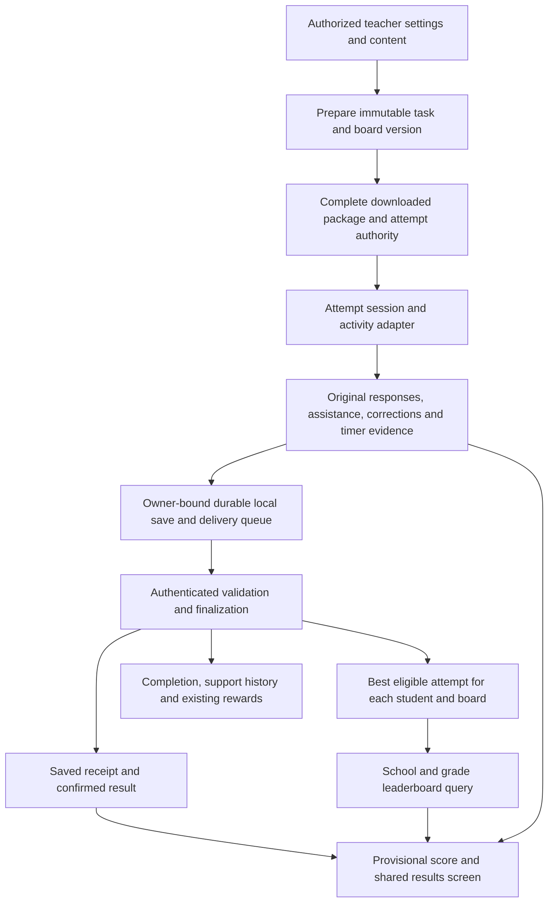
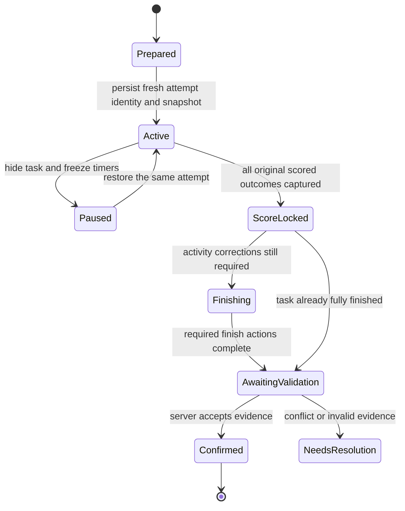

# Sparks animated learning results: technical design

Author: pjrios  
Date: 2026-11-15  
Status: Approved design with local implementation completed. Hosted release acceptance and deployment remain open. See the [implementation record](implementation-status.md) for current evidence and limits.  
Source of approved product rules: [concepts brief](concepts_brief.md).  
Review method: Single-agent drafting and reconciliation. No subagents or independent Goldfish review.

## Overview

Extend Sparks' activity-result system so each scored learning attempt produces an understandable result without confusing performance, passing, rewards, and ranking. Students see their weighted result, accuracy and speed points, stars, longest combo, completion target, correction/retry route, and eligible leaderboard position. Teachers can set passing targets, inspect attempts and help flags, and calibrate a shared competitive speed target from student work.

Cover all eleven scored vocabulary games and both automatic reading-check paths. Use the activity-specific rules in the approved brief rather than treating every game's existing progress percentage as accuracy. Keep written reading responses available for teacher review and outside automatic correctness.

This design specifies task and attempt records, deterministic scoring, activity adapters, scored-time events, prepared offline work, server validation, best-attempt ranking, and compatibility with current progress and reward contracts. It distinguishes a locally calculated provisional result from one confirmed for the official leaderboard.

The technical plan defines the architecture and user journeys. The detailed implementation section defines the records, RPC signatures, offline preparation protocol, file changes and verification gates. Design approval is separate from implementation and deployment authorization.

## The problem

Sparks already has activity callbacks, attempt creation, saved state, progress synchronization, best/latest result fields, rewards, and an arcade leaderboard. Their current meanings are not sufficient for the new shared results experience.

Some activities report eventual words completed rather than first scored responses. Reading checks combine keyed multiple-choice correctness with written-response completeness. The existing payload carries a progress score, completion/finish flags, evidence, state, and active work time, but those fields do not establish the new per-appearance credit, normalized spelling credit, or competitive timing contracts.

A general active-work timer also includes work that must not reduce the speed score, such as study and corrections. Shared puzzles, repeated-word rounds, falling-word choices, and editable reading forms need different timing and submission boundaries. Persisting only a final number cannot explain whether a hint, correction, or resume changed the outcome.

The new design must preserve current progression and existing XP/coin behavior while introducing separate game-point results. Otherwise a corrected run might appear perfectly accurate, a weaker replay might overwrite a better game result, or a queued offline result might appear officially ranked before validation.

### Local integration evidence

| Inspected source | What it establishes | Consequence for the technical plan |
| --- | --- | --- |
| `js/student/studentActivityAttemptService.js`, `startVerifiedActivityAttempt` | Current authenticated startup requests an attempt from the server and rejects startup when `navigator.onLine` is false. | Prepared scored offline starts need an explicit extension. They are not an existing capability established by this draft. |
| `js/student/studentActivityAttemptService.js`, `buildActivityProgressPayload` | Current progress payload includes attempt ID, context, active seconds, progress score, finish/completion flags, evidence, metrics, and saved state. | Define new evidence and timing contracts rather than reinterpreting the legacy fields silently. |
| `js/student/studentActivityResultProcessor.js` and the historical audit | Current result integration retains progress and best/latest attempt information and presents reward feedback. | Separate best game points from legacy progress selection and retain the current reward/progression contracts. |
| [Local audit](audit.md), including the reading and puzzle source checks | Existing games expose different result units, and a whole reading submission can currently be treated as eventual completeness. | Implement each approved score unit and separate submission, score locking, corrections, and passing. |

These are local code observations, not evidence of the deployed database or website. Historical runs of 63 and then 70 existing tests preceded this feature; they are not acceptance tests for the new design.

## Goals

1. Cover every approved activity through an explicit scored-task contract. Each result must identify its complete task, activity, content/settings version, original scored responses, assistance, corrections, and timing. A finished task, completed review, and passing outcome must remain distinct.
2. Reproduce the approved scoring exactly. Calculate up to 950 accuracy points and 50 speed points using the same exact weighted percentage. Apply the shared 80% speed gate, linear decay from the teacher's target to twice that target, one final floor, and the approved star thresholds. Client previews and server-confirmed results must agree.
3. Preserve per-activity evidence. Ordinary questions use first-answer full/half/zero credit. Matching and Speed Match average scheduled appearances per word and then words equally. Crossword and Fill in Blank use approved normalized letter-position partial credit. Wordle, Hangman, and Word Search retain their own approved word outcomes. Corrections cannot change original scored credit.
4. Keep completion controls separate from competition. Support whole-number passing targets from 1% to 100%, with individual override before class/activity setting before the 80% default. Preserve target snapshots, require full retries when needed, retain earned completion after weaker replays, and implement the approved help-flag lifecycle.
5. Account for scored time without charging for excluded work. Preserve pause-and-hide, study/help/correction exclusions, Speed Match's usable-choice intervals, one stopwatch per shared puzzle, and reading time only in the separate multiple-choice section. Restoring state must neither discard previous time nor count an answer twice.
6. Support learning without adding combo points. Apply full-credit unaided streaks, approved resets and milestones, longest combo per attempt, and resume persistence. Reading choices remain editable until whole-check submission; score and combo feedback appears only after locking those answers. Preserve submitted writing on full multiple-choice retries.
7. Produce the approved school/grade learning boards. Use comparable activity/content/task/speed versions, one best full-attempt score per student, shared ranks, competition numbering, time/name display ordering, and the top five ranks plus the student's own entry. Otherwise valid late and below-personal-target full attempts remain eligible.
8. Support prepared scored offline work honestly. Require the complete activity and settings downloaded beforehand. Show local results as waiting to sync, retain pending evidence, and admit results only after synchronization and server validation. Unprepared offline work is practice, not a ranked attempt.
9. Preserve confirmed outcomes under recovery and version changes. Duplicate saves, concurrent tabs, refreshes, resumed old-version work, and stale responses must not mutate a locked score, mix attempt evidence, grant duplicate rewards, or move an old result onto a new board.
10. Make results understandable and usable. Separate current result, personal best, prior earned completion, provisional saving, and confirmed rewards. Provide keyboard access, reduced-motion presentation, skippable celebrations, and access controls that keep private targets and teacher notes out of leaderboard responses.

Success means these behaviors can be verified through score examples, activity contracts, persistence/recovery checks, server access/validation checks, and authenticated user journeys. Classroom timing and hosted capacity require their own evidence; passing technical checks alone will not establish either.

## Non-goals

- Changing school grades, existing XP/coin award schedules, or creating extra combo rewards.
- Automatically judging written-answer correctness, research quality, or reading-only completion as an accuracy score.
- Combining unrelated activities, schools, changed scored content, or incompatible task settings into one cumulative board.
- Adding unsupported grades or treating this work as a redesign of the separate arcade games.
- Backfilling invented first-answer, assistance, or competitive-time measurements into historical records.
- Adding a general teacher mastery override or changing assignment lateness policies. Late leaderboard eligibility does not itself override assignment rules.
- Claiming proctored or tamper-proof competition from client-reported timing. The architecture section must describe the actual validation boundary and its limitations.
- Implementing application code, applying migrations, deploying the feature, or declaring classroom/device acceptance during this design workflow.

## Design decisions

The product decisions in the concepts brief remain authoritative. The technical plan and implementation section resolve the following engineering questions:

- Where immutable task/settings snapshots, per-appearance evidence, scored intervals, locked outcomes, and best-board entries live relative to existing attempt and progress records.
- How prepared offline tasks use device-created unique attempt IDs, validate them on sync, and retain their saved board version after settings or content changes.
- How answer validation, normalized partial credit, exact arithmetic, timing plausibility, authorization, and idempotent reward finalization are enforced without trusting client point totals.
- How shared puzzle and reading-section controllers prevent scored and correction work from being counted simultaneously, and how lifecycle events persist elapsed time.
- How to introduce the new contracts without breaking old clients, current progress gates, reward ledgers, or best/latest compatibility fields.

The approved scope and score rules apply throughout. The following sections record user journeys, architecture, alternatives, the complete file manifest, and access, performance, rollout and verification requirements.

## Section approval

| Section | Approval state |
| --- | --- |
| Overview, problem, goals, and non-goals | Approved. |
| Technical plan and critical user journeys | Approved, including the corrected replacement-device behavior and recovery rules. |
| Alternatives considered | Approved. |
| Detailed implementation and verification plan | Approved. |

The [approved brief](concepts_brief.md) remains the product authority. The [planning context](working-hypothesis.md) and [audit](audit.md) preserve prior decisions and evidence limits.


## Technical plan

This section describes the contracts needed to implement the approved brief. Its record and operation families are logical descriptions; the detailed implementation section binds them to exact planned records and RPC signatures. These are planned contracts, not existing database objects. A1 is approved: official scored attempts, evidence and results live in separate records in the same database, linked to the existing progress system. A2 is also approved: the device creates each fresh attempt ID and the server validates and claims it when syncing. Revised A3 is approved: students can sign in and continue scored work on a replacement computer without teacher approval or a pending-sync device lock. Conflicts are handled at the individual-attempt level. Crash recovery is approved: resume the same attempt from its last saved timer value and keep the speed bonus available under the normal rules. Support-history behavior is also approved: uncertain failures remain visible but do not reactivate a cleared help flag; two clearly post-pass full failures are required. The detailed implementation section specifies the schema, operations and verification.

### Critical user journeys

| Journey | Required behavior |
| --- | --- |
| Student finishes below their target | Freeze original credit and scored time. Finish any activity-specific correction requirements. Show points, stars, target and review route. A valid full run can enter its board despite failing the personal target. Review leads to a new full shuffled retry. |
| Student passes with corrections remaining | Show that the score has been recorded and corrections remain. Required corrections must finish before earning completion. Corrections cannot raise points, restart a scored timer, or build a combo. |
| Student starts with a prepared download while offline | Verify the local package is complete, bound to the signed-in storage owner, and usable for a scored attempt. Save a new identity and frozen configuration before play. Show the result as `Waiting to sync`. Official completion, rewards and ranking await server acceptance. |
| Student switches or replaces computers | Sign in normally on the replacement computer and load server-saved progress. Continue scored work without teacher approval or waiting for the original computer to sync. Resume from a confirmed checkpoint when available, or start a fresh full attempt with a new ID. Work saved only on an inaccessible computer cannot be reconstructed. |
| Student pauses, refreshes or resumes an old task | Hide the task and freeze gameplay. Restore the same answers, assistance, schedule, scored time, combo and configuration. After a crash, use the last saved timer value and retain normal speed-bonus eligibility; count no closed time or estimated missing time. A newer speed target or word list does not migrate this attempt onto a different board. |
| Student submits a reading check with wrong choices | Require all required responses, then lock the automatic choices and writing reference together. Calculate multiple-choice performance even when some choices are wrong. Show combo feedback afterward in question order. A full multiple-choice retry retains the submitted writing. |
| Teacher changes settings shared by several sections | Validate authority and show which school/grade board and sections are affected. Publish a new version for changes to speed target, scored content or appearance count. An individual completion-target change affects new attempts without splitting the board. |
| Student repeats a task or a request is delivered twice | A fresh full attempt can improve the best result. Duplicate delivery of the same attempt cannot create another score, failure, reward or combo event. Preserve previously earned completion after a weaker replay. |

### Components and data flow



The attempt session coordinates saving and state changes. Each game adapter reports evidence in that game's agreed scoring units. A shared pure calculator produces the client preview. The server independently validates the evidence and derives the official result from its saved task. It must never accept a browser-supplied points total, completion flag, combo count or board ID as authority.

A results presenter consumes a result model, rather than inspecting each game's private state. The presenter labels provisional and confirmed data explicitly. A leaderboard repository serves the new learning boards separately from the existing arcade `scores` repository.

The principal costs of this design are larger saved evidence, server validation for every supported activity, and compatibility with existing progress/reward writes. A shared presenter alone would not solve those problems.

### Logical records and immutable versions

| Record | Required contents and constraints |
| --- | --- |
| Shared task version | School, supported grade, activity, reusable content-set identity, content revision, scoring-rule version, normalization policy, shared speed target, repetition count where relevant, generation/timing rules, and board identity. Retain the expected answers and validation rules on the server. |
| Prepared package | Reference to a registered task version, all required content/assets, saved assignment context, effective target snapshot, format version, integrity manifest, and authority for claiming device-created scored attempts during sync. Local preparation is ready only after all required pieces are saved successfully. |
| Attempt | Unique identity, student owner, assignment/section context, shared task/board version, effective completion target and its source, attempt kind, preparation reference, shuffled schedule or layout, lifecycle revision, and authoritative receipt references. Practice cannot become ranked by changing a flag at submission. |
| Original evidence | Stable word/question ID and appearance ID, first scored response or final challenge outcome, assistance affecting that opportunity, ordering, and sufficient game evidence to recompute credit. Each opportunity can have only one locked outcome. |
| Timing evidence | Ordered usable/pause/resume/submission events, interval IDs, accumulated scored milliseconds, separate work-time measurements, and restart checkpoints. There can be at most one scored interval running in an attempt. |
| Correction/review progress | Which original outcomes require correction or review, evidence of the required action, and its own revision. It can advance after score locking without editing original credit. |
| Locked result | Exact weighted credit, scored milliseconds, component values or exact inputs, whole points, stars, longest combo, scoring version, task-finish state and validation outcome. Record why a run is or is not eligible for its board. |
| Support/completion history | Original target comparison, full-attempt outcome, required correction/review state, pass event, failure count since the latest accepted pass, help-flag events and previously earned completion. Scope these to the assigned activity. |
| Best board entry | Board plus student as unique key; chosen attempt ID, points and time from that same attempt. Display name is school-directory data, not an authorization input. |
| Delivery receipt | Owner, unique operation ID, canonical payload hash, accepted revision, outcome and result references. The same operation ID with different contents is a conflict. |

Keep assignment and section identifiers on the attempt for access, reporting and completion. They must not split boards when the approved school, grade, activity, content and shared task settings are equivalent. Conversely, equal text alone must not merge unrelated content sets.

Stable IDs identify words and questions independently of screen order. An appearance key identifies one scheduled opportunity for one word. Question options also need stable identities so shuffling cannot change the expected answer. A retry gets a new attempt identity, a complete schedule and fresh evidence; resume keeps the old ones.

Publish immutable task versions through a canonical representation. Reordering JSON object keys must not create a new board. Changes to scored words, answers, questions, shared speed target or repetition count do. Changes to scoring, normalization or gameplay rules that affect comparability also require a distinct version; do not silently recompute historical results. Pure display edits can retain the version only when they do not change the scored task or reveal additional answer information.

Use shared speed settings owned by the school/grade/task configuration, rather than whichever section opens last. Authorized teachers edit that shared configuration through a revision-checked write. A stale edit returns a conflict and the current version. Individual target precedence is resolved separately and frozen when the attempt is prepared or started. Settings changes never rewrite a resumed attempt's snapshot.

Before publication, reject an empty scored set, missing answer keys, invalid targets, duplicate IDs, unusable distractors, failed puzzle placement, and words that become ambiguous under normalization. Do not reduce a puzzle's scored denominator because generation could not place every word. The detailed implementation section fixes generation bounds, repetition-count limits, supported character rules and field-specific validation errors.

### Attempt lifecycle and concurrency



Transport state is separate from learning state. An online attempt can have confirmed checkpoints before its final submission. An offline score can be locally locked while still waiting to sync. A confirmed below-target full run remains a failed attempt for completion and a potentially eligible result for the board.

`scoreLocked`, `taskFinished`, `reviewFinished`, `passedTarget`, `completionEarned` and `boardEligible` are distinct derived facts. Score locking happens after all original scored outcomes exist. Activity-specific corrections can delay full task finish. General post-result mistake review gates the retry route without changing the frozen score. A passing result earns completion only after its required finish/review rules are satisfied.

Persist response evidence and the corresponding timer stop as one local state change before feedback or advancement. If the save fails, keep the interaction at that boundary and expose the unsaved state. Do not offer a resume that silently drops a saved answer or recorded time. Persist pause before showing a paused screen; restore paused after reload until the student resumes. Record periodic time checkpoints while active. Under the approved crash rule, recover the last valid saved timer value rather than estimating time since that checkpoint. A crash alone does not remove speed-bonus eligibility. Retain the checkpoint/recovery facts for validation; do not mislabel unrecorded time as exactly measured.

Use an expected revision on server writes and unique event/appearance constraints. Local tab coordination can discourage two writers, but the server revision is the final guard. Divergent histories return a conflict; do not choose the higher score or merge competing first responses. Owner checks must run before delivery and before applying a response to the visible session. Logging out must preserve pending work under its original owner and prevent another student from seeing or syncing it.

Approved support-history policy: after a confirmed pass, failures whose position relative to that pass is uncertain remain in attempt history but do not increment the current help counter or reactivate a cleared help flag. Require two distinct validated, fully finished, below-target attempts whose starts are demonstrably after the latest confirmed pass. Preserve known predecessor and start-context references; neither a device clock nor upload arrival order establishes that relationship. Capture the context at attempt start rather than assigning the latest pass to old evidence when it uploads. Replacement-device access remains unrestricted. The section below defines the validation and projection requirements.

### Scoring and evidence validation

Use a reduced fraction for each credit and for the aggregate weighted fraction `p`. Calculate comparisons by cross multiplication with safe integer arithmetic. Variable word lengths make floating-point rounding near an integer boundary unsafe. The final implementation must use an equivalent exact representation in the browser and database and prove equivalence with common fixtures. JSON transports large integer numerators and denominators as strings if needed.

For Matching and Speed Match, calculate each word's sum of appearance credits divided by its scheduled count, then average those word values. Validate that every planned appearance exists exactly once. A correct correction to an already scored appearance cannot become another observation. Matching attributes a wrong pair to the selected term even when the definition card was selected first.

For Crossword and Fill in Blank, normalize before comparing positions. Ignore case, outer whitespace, internal spaces and hyphens as approved. Divide matching positions by the larger normalized length and halve that fraction if extra help was used. Normalize expected and submitted answers identically. Canonical Unicode normalization can preserve the same character represented in different code-point sequences; broader accent or punctuation removal has not been approved. The detailed implementation section defines the versioned character, lowercase and hyphen policy. Do not substitute edit distance for position matches.

Ordinary questions retain the first response and assistance state. Wordle retains guesses and the within-six outcome. Hangman retains letter actions and the before-six-wrong-letters outcome. Scramble retains the first complete submitted arrangement. Word Search retains valid found-word paths and any location assistance. Crossword retains the submitted letters for each complete word check and all explicit reveals affecting still-unscored crossing words. Flashcards retains first mastery responses separately from study and subsequent correction. The server checks these against its task snapshot; browser counters alone are insufficient evidence.

Calculate the approved formula with integer milliseconds for both `t` and `T`:

```text
accuracy = 950 * p
speed = 0 unless taskFinished and p >= 4/5
if eligible: speed = 50 * clamp((2*T - t) / T, 0, 1)
points = floor(accuracy + speed)
```

Keep exact component values or exact reproducible inputs even when the screen displays rounded values. Floor once after addition. Compare the personal whole-number target against exact `100*p`. Derive stars from final whole points, with five only at 1000. Do not reuse the legacy 0-100 progress `score` field for these points.

Useful contract fixtures include:

| Inputs | Expected result |
| --- | --- |
| `p=1`, `t=T` | 1000 points, five stars. |
| `p=1`, `t=2T` | 950 points, four stars. |
| `p=4/5`, `t=1.5T` | 785 points, three stars. |
| `p=799/1000`, `t<T` | No speed bonus; 759 points even if a rounded display says 80%. |
| `p=80/99`, `T=100000 ms`, `t=199000 ms` | Accuracy is about 767.6768 and speed is 0.5; combined floor is 768. Flooring each component would incorrectly give 767. |
| Three full-credit appearances out of five for one word | That word contributes `3/5`, regardless of correction clicks. |
| `COMPUTERS` for `COMPUTER`, unaided | `8/9` letter credit. |

Recompute combos from the accepted ordered outcomes. Only credit exactly one with no extra assistance builds a streak. Partial, assisted, missed and wrong outcomes reset it. Intermediate permitted guesses and unscored drags do not independently create combo events. Milestones are 3, 5, 10 and every further multiple of 5. Reading uses the saved question order after submission. Corrections and writing never build a combo. Current and longest streak survive resume; rendering the same accepted event twice cannot increment either.

### Scored timing and pause behavior

The existing work timer remains the source of general activity-time reporting and existing lateness behavior until a deliberate compatibility change is designed. A separate scored-time controller receives semantic activity events. It uses a monotonic clock within a page lifetime and persists accumulated integer milliseconds. Wall-clock timestamps support diagnostics, not subtraction across a sleeping browser or a changed device clock.

| Adapter | Scored interval |
| --- | --- |
| Flashcards | Mastery answer interaction usable to first mastery submission. Study is outside it. |
| Quiz, Synonym/Antonym, Scramble, Fill in Blank | Usable scored question or arrangement to its first scored submission; help and correction modes pause it. |
| Matching | Usable pairing opportunity to first submitted pair for its appearance. Prevent overlapping appearance timers from charging the same active work twice. |
| Wordle, Hangman | Usable word challenge through its permitted guesses until the word resolves. Intermediate guesses retain accumulated time. |
| Crossword, Word Search | One accumulated stopwatch for the whole visible shared puzzle. Pause in excluded modes; stop after every target has its original scored outcome. Never sum per-word timers. |
| Speed Match | Definition plus usable initial group containing the correct word and distractors to first selection or missed correct target. Pause motion during required correction. No scored waiting before choices are usable. |
| Reading multiple choice | Accumulate visits to the separate multiple-choice section until whole-check submission. Switching to reading or writing hides choices and pauses timing, preserving drafts. |

Pause, blur, hidden-page navigation and explicit leave route through a common controller that hides the scored task and freezes gameplay. Help, correction, feedback and any celebration that interrupts play use mutually exclusive modes. A nonblocking combo counter can coexist with active play; it must not hide usable answers while leaving a timer running. Give reduced-motion and keyboard users the same scoring boundaries.

Crossword needs a restricted correction mode so a student cannot pause the whole-puzzle stopwatch and work on still-unscored words. Hide or disable those words while correcting, then restore the scored puzzle and timer together. Word Search help marks the affected word assisted and cannot expose an interactive free-timed puzzle. Retain time already spent before assistance.

Speed Match must use elapsed time for motion, preserve fall positions on pause and restore the scheduled appearance. Validate generation includes the correct target on every appearance. A wrong selection or missed target locks zero, stops the scored interval, and requires the correct match before the next appearance. Correction clicks create no new scored time or combo opportunity.

Validate finite nonnegative intervals, sequence, known opportunities, no overlaps, nondecreasing totals and plausible bounds. These checks detect inconsistent evidence. They cannot prove a browser faithfully reported physical response time or hid every question. Offline content and client-reported interactions remain inspectable and modifiable. Do not describe this as proctored competition or use old minimum-work-time guards as a substitute for the approved speed rule.

### Crash recovery and recorded scored time

Approved by the user: resume from the last saved timer value and keep the speed bonus available. Use the same attempt ID and original task/settings version. Restore a consistent saved checkpoint containing answers, assistance, corrections, current/longest combo, gameplay state and accumulated scored milliseconds. Choose the latest valid checkpoint in that attempt's revision history, not independent values taken from conflicting branches.

Save original response evidence and its stopped timer value before showing feedback. Save accumulated time periodically during active questions and puzzles, and on pause or leave whenever possible. The final implementation specifies the save cadence and storage-failure behavior. Lifecycle callbacks are an additional save opportunity; recovery cannot depend on a browser delivering a final shutdown callback.

If the saved checkpoint contains an open interval, recover its recorded accumulated total and mark that interval interrupted at the checkpoint. Begin a new interval only when the student explicitly resumes a usable scored interaction. Do not subtract device wall-clock timestamps across the interruption, add closed time, estimate unrecorded seconds, restart accumulated time at zero or allocate a fresh scored opportunity. Recovered Speed Match motion and puzzle state must use the same saved state rather than simulating time while closed.

The score calculator and server validator use the recovered recorded total. An interruption marker explains the recovered interval and is not by itself an invalid-timing finding. Full-run requirements, the shared 80% weighted-credit gate and the normal speed formula still apply. No separate crash penalty or automatic speed-bonus exclusion is added. Other evidence conflicts or validation failures remain governed by their ordinary rules.

There may be unrecorded time since the last successful save. This is an accepted limitation, not evidence that the elapsed duration was zero. Save diagnostics must distinguish recorded scored time from unavailable time. Do not fabricate answers or later state that the checkpoint does not contain. Same-device recovery uses available valid local state; replacement-device recovery can use only state that actually reached that computer or the server.

Acceptance examples include a saved total of 12,000 ms, a crash and five hours closed, followed by 8,000 ms of active resumed work producing 20,000 ms of recorded scored time. Normal speed points remain available. A saved assisted answer remains assisted; restoring an accepted answer cannot build its combo twice; and repeated recovery/delivery preserves the attempt ID and cannot grant duplicate rewards.

### Prepared offline work and delivery

A scored download must contain a complete immutable configuration, not just cached vocabulary. Write a readiness marker only after all content, assets, settings, generation data and attempt authority are saved. Check integrity and ownership before offering a scored start. Missing preparation permits practice only. A manifest hash detects mismatch against a server-registered version; a hash supplied solely by the browser proves no authority.

The preparation operation must be idempotent and return enough information to recover a lost response. Freeze the effective completion target and original board version in that preparation. Version changes after download do not invalidate comparability with the original board. Current authenticated access is checked when syncing; revoked access must produce a visible unresolved result rather than a fabricated confirmed score. Deadline lateness alone cannot disqualify an otherwise valid full run.

Save the attempt identity before any scored interaction, and keep original evidence until a matching acceptance receipt has been saved locally. Delivery can retry the exact same immutable operation. Mutable checkpoints can replace earlier unsent checkpoints only when they contain all evidence required to recover; terminal submissions and original responses cannot be discarded by the existing progress coalescing behavior.

With A1 and A2 approved, device-created IDs enter the separate results system through an authenticated claim operation. Fresh full retries do not consume a reserved server ID pool. The claim contract must support old-version resume, owner isolation and duplicate prevention. The current server-only startup, four-hour reuse window and seven-day unfinished cleanup cannot be applied unchanged. An offline preparation must never disappear merely because legacy cleanup assumes it was abandoned.

Network failure leaves the result waiting to sync. Invalid or conflicting evidence produces a saved, actionable error state. Do not retry a permanent rejection forever or let the local result impersonate an official one. If local storage fills, retain existing pending submissions and stop creating scored work that cannot be saved. Exact retention periods, package-size limits and recovery messaging remain engineering parameters for the detailed plan.

### Finalization, completion and reward compatibility

Finalization uses one transaction or an equivalent all-or-nothing server operation. Check authenticated owner and current access, lock the attempt and relevant completion/support records, validate the immutable task and evidence, calculate the official result, record the receipt, and update the best entry if eligible. When required finish actions remain, preserve locked original evidence and accept later correction progress without regrading it.

Record each validated full below-target result once in failure history. On passing with required corrections/review satisfied, preserve completion, clear the help flag and reset the current failure counter. After a pass, only clearly post-pass full failures contribute to that counter under the approved uncertainty rule below. Two such failures reflag without revoking already-earned completion. Practice, incomplete saves, uncertain older failures and duplicate receipts do not increment the post-pass counter. Historical support events remain available.

Existing XP/coin schedules and reward-ledger identities remain authoritative. Adapt new validated completion facts into that reward boundary without calling an old path that recomputes completion using incompatible legacy metrics. The older progress procedure performs access, progress and reward logic together, so simply writing weighted accuracy into its `score` parameter is insufficient. The detailed plan must trace and preserve each existing award trigger, including first completion, before defining the bridge.

Keep legacy progress, latest attempt, best progress, best game result and previously earned completion distinct. Existing clients continue their existing path. They cannot create ranked new-format results without the required evidence. Historical attempts retain their recorded meaning; no synthesized assistance, first-answer credit or speed measurements. Read-only migration diagnostics may identify adequate evidence, but competitive backfill requires a separate explicit eligibility design.

### Reading checks and writing revisions

Both the vocabulary reading activity and classroom check form must use the same automatic-attempt contract. Replace any use of all-correct status as submission completeness. A valid whole-check submission requires every required response, including writing, while automatic credit uses multiple choice only. Text length or presence checks establish that writing was submitted, not that it was correct.

A whole-check submit locks the multiple-choice response set and references an immutable writing revision. If offline, it locks locally immediately and shows provisional feedback. Later sync cannot apply answer edits to that locked attempt. A retry creates a new complete multiple-choice attempt and references the preserved writing; no automatic credit is awarded for that writing. Later permitted writing edits create a new revision, preserving the earlier submission for teacher review.

Multiple-choice drafts and timing persist across section switches. Correctness and combo outcomes remain hidden until whole-check submission. No-multiple-choice checks continue their existing reading/writing flow without invented points, stars or a ranked automatic result.

### Leaderboard selection, access and query cost

For each board/student pair, choose the eligible full attempt with highest whole points, then shortest scored time. Preserve points and time from that same attempt. An exact personal points/time tie can retain a stable attempt ID for reproducibility without creating another competitive distinction.

Rank equals one plus the number of eligible student entries with strictly higher points. Time affects display order inside a shared rank. Name and stable student identity resolve exact display ties. Thus 1000, 990, 990, 980 gives ranks 1, 2, 2, 4. Select ranks at most five, including every tie there, then include the student's own entry if absent. Do not use `limit 5` on raw rows or filter to five distinct point values.

Persist or derive a best-entry projection with a unique board/student constraint and indexes supporting board, points, scored time and student lookup. This projection belongs to the separate results system selected under A1; the detailed schema will define its physical form. Rank and top/own results must use the same consistent query snapshot. Large ties may require paging within a rank; paging must preserve access to all qualifying ties. Do not truncate tied students silently. Verify query plans and realistic school-sized boards before choosing caching or claiming capacity.

Authorize every board read using current school/grade access. Return only permitted display identity, points, rank, scored time and the viewer's own result references. Do not return personal completion targets, help flags, written work or another student's answers. Settings edits require existing authorized school/teaching roles. Derive school, grade and membership from trusted records, not arbitrary client JSON or editable profile metadata.

Keep privileged validation in the private database boundary with an empty or fixed safe search path, explicit grants and authenticated exposed wrappers. Review RLS on any exposed data and ensure views do not bypass intended access. Existing owner-bound write methods are a useful integration point, not proof that newly added operations are authorized correctly. No client service-role credentials are required.

### Source integration and proposed changes

This section records the planned integration. The final implementation uses dedicated learning runtimes behind the existing launchers; the [implementation map](implementation-status.md#implementation-map) records actual file ownership. Legacy paths remain available for unpublished activities and teacher previews.

Paths below are relative to `apps/sparks/`. This is a component map; the detailed implementation section contains the exhaustive file manifest and test commands.

| Existing component | Planned change |
| --- | --- |
| `js/student/studentActivityAttemptService.js` | Start/resume through the versioned task contract; handle prepared offline authority; carry new evidence without changing legacy score meaning. |
| `js/student/studentActivitySession.js`, `studentActivityStateStore.js`, `studentActivityAutoSave.js` and `js/student/persistence/studentStorage.js` | Save owner/attempt/revision identity, immutable outcomes, assistance, timing checkpoints, corrections and combo state together. |
| `js/student/studentActivitySyncCoordinator.js` | Add ordered final-result delivery and receipts; keep terminal evidence safe from checkpoint replacement; handle conflicts and stale-owner responses. |
| `js/student/studentActivityWorkTimer.js` | Preserve general work reporting and coordinate lifecycle signals with a distinct scored-time controller. |
| `js/student/studentActivityResultProcessor.js` and progress/gate integration | Consume validated completion and rewards while presenting current result and game personal best independently. |
| `js/services/studentApi.js`, `js/supabaseStudentWriteOperations.js`, `js/supabaseStudentWriteMethods.js` | Add owner-bound preparation, checkpoint/finalization and result-query operations, cancellation and explicit retry/error handling. |
| Activity modules under `js/activities/`, including Matching, Speed Match and Crossword helpers | Emit each approved scoring unit, correction and timer boundary; remove conflicting finish behavior and retain complete schedules. All eleven vocabulary games are in scope. |
| `js/activities/sparkReading.js`, `js/sparkCheckModel.js`, `js/classroomSparkCheckView.js` | Separate MC completeness/correctness, sections and timing; lock submissions; preserve writing revisions on full MC retries. |
| `js/teacherVocabularyActivityFlowMethods.js` and the owning teacher progress/settings views | Manage shared settings and personal targets, version changes, support flags and explanatory previews. The detailed manifest identifies the owning settings, insight and class-progress views. |
| `js/services/leaderboardRepository.js` | Keep the existing arcade board contract; introduce a separate learning-board reader with school/task/version scope, shared ranks and top-plus-own behavior. |
| `supabase/migrations/` | Add separate versioned results records, private validation/query operations and a transactional progress bridge; preserve existing wrappers and reward contracts. No migration is created during drafting. |

New logical modules comprise a scoring calculator, versioned task validator, scored-time controller, per-activity evidence adapters, prepared-task store, result delivery repository, shared accessible presenter and learning-board repository. The detailed manifest assigns their filenames and responsibilities. They will be created during implementation.

Proposed operation families are `prepare task`, `start or claim attempt`, `save checkpoint`, `lock/finish attempt`, `save correction/review`, `read result`, `read board` and `publish settings version`. Requests carry an expected owner, operation ID, task/attempt reference and expected revision where applicable. Responses carry accepted revision, receipt, validation state, confirmed derived facts and retryability. The detailed implementation section specifies exact wire names, batching, size limits and compatibility versions.

The source review also found these migration constraints:

- `20260822144658_replace_expired_activity_attempts.sql` reuses unfinished attempts inside four hours and deletes unfinished records older than seven days. Prepared/resumable new-format attempts need explicit lifecycle and retention handling.
- `20261026121540_simplify_progress_compatibility_and_row_lock.sql` uses request hashing, receipt/attempt locks and legacy progress delegation. Preserve idempotency and owner/context validation while replacing incompatible scoring assumptions deliberately.
- `20260816174250_activity_attempt_results.sql` stores attempt evidence and best/latest progress references. These provide integration points but do not establish the new weighted-score or board semantics.

These observations come from local files, not the hosted schema. A deployment comparison is required before any later migration execution.

### Approved architecture choices

#### A1. Where official scored results live

Approved by the user: use separate results records linked to the existing progress system, within the same database. Keep the existing reward ledger as the reward authority and preserve current access checks. The comparison below retains the rationale; the existing-attempt extension is not selected.

| Option | Mechanism | Tradeoffs | Failure conditions |
| --- | --- | --- | --- |
| Extend existing attempt records | Add versioned task references and new result fields to the existing attempt system, with child records for evidence as needed. New validation shares the attempt lifecycle and bridges to existing progress/reward operations. | One attempt identity to trace; migration and old/new client coexistence affect the central progress path. Legacy best-progress fields still need distinct semantics from best game points. | Old cleanup, expiry, completion guards or client writes reinterpret/delete new records; migration fails to isolate old scoring versions; reward code is invoked twice. |
| Separate results records linked to existing progress | Store versioned scored attempts, evidence and results in dedicated records. Link their accepted outcomes to legacy progress/completion and reuse its reward ledger through an idempotent bridge. | Competitive data can evolve and roll back separately; operators must trace two linked histories and maintain atomic bridge writes. Existing progress views need explicit joins or projections. | The bridge saves a result but loses completion/rewards, grants rewards twice, or creates unmatched attempt references; offline replay diverges between the two histories. |

A1 is settled. New-format scored attempts, original evidence, timing, locked outcomes and learning-board best entries belong to the separate results system. Existing progress retains its current meaning and links to accepted new results through explicit references.

Use one database transaction to save an accepted result and any resulting progress, completion, support-history and existing reward-ledger changes. Stable result/event references and uniqueness constraints must prevent duplicate bridge effects on replay. Score locking may precede required corrections; the later completion transition uses the same idempotent bridge without recalculating original credit.

The implementation plan must trace both histories through the result/attempt references, enforce bridge integrity, and preserve accepted new-format records during rollback. It must not require creating a duplicate legacy attempt solely to store game points or route new results through legacy scoring guards.

#### A2. How prepared offline attempts get identities

Approved by the user: create each fresh attempt ID on the device and validate the attempt when it syncs. A complete prepared activity, immutable registered settings, owner checks and server validation remain required before any official result. An ID identifies a run; it does not prove the reported answers or time. The comparison below retains the rationale; reserved server ID pools are not selected.

| Option | Mechanism | Tradeoffs | Failure conditions |
| --- | --- | --- | --- |
| Reserve IDs during download | The server reserves attempt identities bound to the student and prepared task. The device saves them and consumes one for each fresh scored run. | Retains server-issued identities; enough IDs must be downloaded for offline retries, with explicit replenishment and retention rules. | Reserved IDs run out during disconnected work, are consumed twice by concurrent devices, or are removed by cleanup before sync. |
| Create IDs on the device | The device saves a fresh unique ID before each run. On sync, the server claims it against the authenticated owner and registered preparation, validates the evidence and returns a receipt. | Does not require replenishing an ID pool for offline retries; adds an authenticated claim operation and strict duplicate, ownership and ordering checks. | A forged preparation is accepted, an existing ID is rebound to a different run or owner, or conflicting histories are merged as if both were valid. |

A2 is settled. Before the first scored interaction, save the fresh ID with its owner, preparation reference, task/settings snapshot and initial state. Use a platform-generated random UUID and persist it durably. Starting a new full retry creates a new ID; pausing, resuming, reconnecting, refreshing or retrying delivery retains the existing ID. An online run can use the same claim contract immediately rather than relying on a separate identity model.

On first sync, the server authenticates the student, checks current access and the registered preparation, and claims the attempt ID for that owner and immutable task. Claimed identity bindings cannot later change. Validate original evidence, correction state and timing before accepting any official result. Client-supplied settings, board IDs, point totals or completion flags are never authority.

A lost acceptance response is recovered by retrying the same operation ID and payload, which returns the saved receipt. Do not allocate another attempt ID after a timeout. The same operation ID with different contents is rejected. A newer mutable checkpoint needs the expected revision; it cannot rewrite locked evidence. Reusing an attempt ID for another owner or task, or submitting divergent evidence at the same revision, is a conflict. Return a non-disclosing conflict response without exposing another owner's records. Only a matching saved receipt permits local evidence cleanup.

Required acceptance cases include multiple disconnected full retries with distinct IDs; refresh retaining one ID; an interrupted claim returning the same receipt on retry; owner/task rebinding rejection; and no duplicate score, failure, completion or reward effects. Generating an ID is not a substitute for the previously approved prepared-download requirement.

#### A3. Replacement computers and attempt conflicts

Approved correction from the user: remove teacher approval and let students sign in on a replacement computer without blocking them. This replaces the earlier one-device pending-work rule and teacher-authorized replacement proposal. The retired-device admission process is also removed; reconnecting computers use ordinary authenticated synchronization and server validation.

Students bring their own computers. A student whose computer is lost, broken or inaccessible signs in on another computer through the normal account flow. Load that student's server-saved progress, completion, rewards, support history and accepted attempts. Another computer's unsynced work does not prevent new scored work. Obtain the complete activity and registered settings normally before a new scored start; the existing preparation requirement still applies to starting while offline.

If a confirmed resumable checkpoint exists, restore that exact attempt ID, saved answers, assistance, accumulated time and revision. Do not claim to restore later changes the server never received. If only inaccessible local work exists, explain that it is not available on the replacement computer and offer a fresh full attempt with a fresh device-created ID. Previously earned completion is retained. Apply existing correction/review requirements to known validated results without introducing a device-transfer gate.

Device identifiers may help diagnose sync events, but they confer no exclusive activity ownership. Remove device ownership generations, release/acquire operations, device handoff receipts and teacher device-move operations from the proposed architecture. Student authentication, assignment access, registered preparation, attempt identity and revision checks remain the validation boundary.

When the original computer reconnects, synchronize its retained evidence through the normal owner-bound claim and validation contract. A distinct valid full attempt remains attached to its original task/settings and board version and can qualify under the approved late-attempt rule. Do not reject an otherwise valid attempt merely because the student used a replacement computer. Apply existing idempotency and reward-ledger constraints so repeated delivery cannot grant another reward.

Conflicting saves of the same attempt are a different case from distinct full attempts. Preserve locked original evidence and check expected revisions. If two computers submit incompatible first responses or resume changes under one attempt ID, retain the conflicting evidence and return an attempt-specific conflict. Do not silently overwrite, merge scored answers, choose the higher score or turn the rejected branch into a fresh official attempt automatically. A conflict in that attempt does not lock the student's account or prevent a separate permitted full attempt. The detailed recovery contract must provide a clear student-facing path.

No teacher approval is required for replacement-device sign-in, continuing scored work or ordinary validation of recovered submissions. Existing teacher access to progress and help flags remains unchanged. Device replacement uses normal student account access.

Required acceptance cases include sign-in and new scored work on a replacement computer while the old computer has unsynced work; confirmed-checkpoint resume with the same ID; clear treatment of unavailable local-only work; a distinct valid old-computer attempt syncing later; duplicate delivery without duplicate effects; conflicting saves isolated to their attempt; owner isolation on a shared replacement computer; and preservation of completion, best scores, rewards and help history.

The approved support-history rule below handles uncertain chronology conservatively without blocking replacement-device access. Crash timer recovery is settled in its own section. Neither recovery rule requires a device-transfer approval or pending-sync lock.

### Help flags when offline failures arrive after a pass

Approved by the user: keep the help flag cleared for uncertain failures and require two clearly new failures to reactivate it. Scope this rule to the student's assigned activity, as with the original support lifecycle. A full below-target attempt still compares exact weighted credit with its own frozen completion target.

Before any qualifying pass exists, count distinct validated full below-target attempts under the original two-failure rule. The uncertain-order exception applies after a confirmed pass, not to the initial support cycle. An uncertain failure does not itself clear an already-active help flag.

Retain a confirmed-pass reference and the current post-pass failure set in the support projection. At a new attempt's start, persist the last confirmed support context known to that session, plus any local predecessor references. A server-issued start/preparation context or a validated predecessor chain must establish that the new attempt started after the relevant pass. A bare client timestamp or a pass reference attached only during upload is insufficient. An offline passing predecessor can establish the relationship once its pass and required finish actions are validated; an unvalidated local claim cannot.

When accepting a full failure, save it in history and classify its relationship to the current confirmed pass. Add it to the current counter only when that relationship establishes a post-pass start. Record one counted support event per result. A failure known to precede the pass or whose chronology remains uncertain stays visible in the teacher history without changing the cleared flag or contributing to the current failure counter. If one clearly new failure has already counted, an uncertain upload leaves that count at one. Two clearly new failures reactivate help.

A confirmed qualifying pass clears the flag and resets the counter under the existing rule. Preserve its reference and causal links when syncing other attempts. Duplicating the pass receipt cannot reset a later counter again. When distinct passing histories are concurrent, record the confirmation history without asserting a real-world order the evidence cannot establish. The exact database projection and transaction ordering must implement the approved conservative behavior and be checked against explicit concurrent-delivery fixtures during detailed implementation.

If later validated predecessor evidence resolves an initially uncertain failure, reevaluate its classification once against the current pass context. Count it only if it is then established as post-pass. A newer pass supersedes the earlier cycle, so late classification cannot revive an obsolete counter. This is evidence reconciliation, not an extra failure event.

Uncertainty here concerns the support flag. It does not invalidate an otherwise valid full attempt, change its original points, remove leaderboard eligibility, revoke previously earned completion or repeat rewards. Teacher history should explain that an attempt's order relative to the pass is uncertain without labeling the student as needing help on that basis. No teacher approval or device restriction is introduced.

Acceptance cases must cover a confirmed pass followed by two uncertain uploads leaving the flag clear; one clearly new failure plus any number of uncertain uploads leaving the counter at one; two distinct clearly post-pass full failures reactivating help; known pre-pass failures arriving late; duplicate receipts; a validated offline predecessor chain; later resolution of uncertainty; and a further pass resetting the current cycle. Replay equivalent evidence without making support status depend solely on request arrival order.

### Rollout and verification boundary

Introduce additive contracts behind a feature/version boundary. Exercise internal checkpoints by adapter while retaining the approved release scope of every vocabulary game and both reading-check paths. The final rollout plan must identify how old clients behave, which validator owns each attempt version, and how a rollback preserves pending new-format submissions. Disabling presentation must not delete immutable records or replay rewards.

Before activation, verify exact score fixtures and boundaries, all per-activity evidence adapters, timer exclusions, original/correction separation, reading answer locking and writing retention, settings versions, owner/access checks, duplicate delivery, conflicts, prepared offline retries, help-counter resets, best-result selection, full tied ranks and reward compatibility. Browser, hosted database and representative-device checks remain separate from pure unit checks. Inspect realistic board query plans and then calibrate speed targets from classroom work.

This turn only drafts and checks planning text. Historical test runs are not evidence that these contracts work. No production source, migration, hosted configuration or student data is changed.

## Alternatives considered

This section records the tradeoffs behind the approved product rules and technical plan. The [concepts brief](concepts_brief.md) supplies the brainstorm alternatives; the architecture and recovery decisions above supply the later comparisons. "Rejected by author" refers to decisions made in this design discussion. No upstream maintainer decision or independent Goldfish review is implied.

Benefits below explain why an alternative could be defensible elsewhere. They are not measured performance or classroom results. Each rejection is scoped to this feature; an internal implementation checkpoint is not a reduced product scope, and an unselected default is not automatically a forbidden teacher setting.

### Scoring, completion and repeated practice

| Alternative | Potential benefit | Cost or failure in this feature | Decision and selected approach |
| --- | --- | --- | --- |
| Let personal passing targets rescale points or speed eligibility | A lower target could make competitive rewards easier to reach for a student receiving support. | Identical performance could receive different points or bonus eligibility across students, undermining the shared grade-level comparison. | Rejected by author: individual targets affect completion only. Use the same exact weighted credit and fixed 80% speed gate for everyone. |
| Use a 90/10 accuracy/speed split or add completion bonuses | Gives speed or finishing a larger role in the game result. | Changes the approved weighting and can make speed or a completion event matter more than intended. | Rejected by author: use 950 accuracy points and at most 50 speed points. Keep existing XP/coins separate. |
| Rank by accuracy first and use time only to break ties | A perfect weighted result would always rank ahead of any imperfect result. | Removes the approved ability for the small speed component to change the ordering of close results. | Rejected by author: rank by combined whole points. Equal points share rank; scored time orders entries within that rank. |
| Keep the latest result or add all replay scores together | Latest shows recent performance; cumulative points make every replay contribute to a growing total. | Latest can erase a better result. Cumulative points mix performance with number of attempts and allow repeated play to dominate the board. | Rejected by author: retain one best eligible full attempt per student and board, choosing shorter scored time among equal-best points. Preserve other attempts in history. |
| Use three scheduled appearances per word as the default | Shortens the repeated Matching and Speed Match task. | Provides fewer scheduled observations than the agreed default. | Not selected as the default by author: use five, with a shared teacher-adjustable count. This does not reject three as a possible teacher configuration if supported by the final validated limits. |
| Sample repeated words randomly without a complete planned schedule | Avoids storing an explicit appearance schedule and can vary play. | Can omit a word or give words unequal numbers of opportunities, making the full-task denominator and comparison unreliable. | Not selected in the approved technical plan: save a complete schedule, average appearances per word, then words equally. |
| Stop Speed Match after three lost lives | Gives the game a familiar short loss condition. | Ends the task before all planned words and appearances have been attempted. | Rejected by author: finish the entire schedule, preserving the zero from each wrong or missed appearance and requiring its correction before advancing. |
| Give zero for every misspelled Crossword or Fill in Blank response | Simple binary scoring. | Discards the agreed evidence from letters in the right positions. | Rejected by author: use normalized positional matches divided by the larger normalized length, then apply the assistance adjustment. |
| Award extra points for combos | Makes consecutive success affect competitive results. | Adds another scoring component and rewards response order beyond the approved accuracy and speed rules. | Rejected by author: keep combos visual, preserve the approved milestones and show the longest streak. |
| Treat eventual correction, text presence or submission completeness as automatic correctness | Reuses existing completion indicators and reduces separate scoring logic. | A corrected wrong answer could become a perfect original score; submitted writing could be presented as automatically judged. | Rejected by author: freeze original credit, keep corrections separate and automatically score reading multiple choice only. Writing remains for teacher review. |

The chosen points formula still has a cost: a sufficiently fast, slightly less accurate run can outrank a slower perfect run. That is an approved tradeoff. The presenter must explain the accuracy and speed components rather than imply ranking is accuracy-only. Likewise, five stars require the full 1,000 points; a perfect slow run can earn four stars without failing its completion target.

### Storage and component boundaries

#### Extend the legacy attempt system instead of adding separate results records

Extending existing records would keep one main attempt identity and reduce the need to trace linked histories. Child evidence records could still support detailed answers and timing. The cost is putting the new lifecycle alongside legacy score meanings, cleanup, expiry and best-progress selection. Old-client writes and existing completion/reward procedures would need careful version isolation.

Rejected by author: use separate scored-attempt, evidence and result records in the same database, linked to existing progress. New game points should not silently change the meaning of the legacy 0-100 progress score. The selected separation also carries a real cost: accepted results, completion, support history and the existing reward ledger must be connected reliably. Save resulting changes in one transaction with stable references and duplicate protection. Separate storage does not justify a second reward authority or unmatched histories.

#### Build complete results logic independently in each game

Independent implementations would let each game evolve without a shared presenter or calculator interface. They could initially fit each game's current state representation with fewer adapter changes. Over time, however, twelve automatic scoring paths could disagree about flooring, target precedence, assistance, provisional state, stars, retries or duplicate feedback.

Not selected in the approved technical plan: use explicit activity adapters, a shared scoring contract and a shared results presenter. The adapters remain responsible for their different evidence and timer boundaries. The shared layer must not force a puzzle stopwatch, a repeated-word schedule and reading-section timing into one incorrect generic interaction model. Shared rules also increase the impact of a calculator defect, so common score fixtures and adapter acceptance examples are necessary.

#### Reuse the arcade leaderboard as the learning board

The existing repository already reads scores by grade and game, so extending its queries could appear to save work. Its inspected contract does not establish school, content/task version, best full attempt, shared rank or all-ties-at-fifth semantics. A row limit of five would not implement the approved display rule.

Not selected in the approved technical plan: provide a separate learning-board contract and retain the arcade board's meaning. This adds a reader/projection and access/query work, but makes school boundaries, comparable versions and rank semantics explicit. The selected query still needs realistic tie-size and query-plan verification; separation alone does not establish performance.

### Offline identity, validation and device access

| Alternative | Potential benefit | Cost or failure in this feature | Decision and selected approach |
| --- | --- | --- | --- |
| Reserve a pool of server-issued attempt IDs during download | Keeps identity issuance on the server and ties reservations to a prepared task. | Requires enough reservations for disconnected retries, replenishment behavior and retention that does not delete unused reservations. Running out could prevent another scored retry. | Rejected by author: create a fresh attempt ID on the device and validate/claim it on sync. Resume and delivery retries retain the existing ID. |
| Permit scored starts only while online | Gives every start immediate server authorization and current settings. | Prevents the approved scored offline work even when the complete activity and settings were downloaded beforehand. | Rejected by author: prepared activities support offline scored starts, with provisional results until server acceptance. Unprepared offline work remains practice. |
| Accept client-computed points as the official result | Simplifies submission and reduces server scoring work. | A browser-supplied total does not establish valid answers, assistance, timing, full-task coverage or comparable settings. | Not selected in the approved technical plan: independently validate and calculate on the server from the registered task and submitted evidence. Client calculations are previews. |
| Lock an assigned activity to one device until all pending work syncs | Simplifies device-history ordering in the normal case. | A broken or inaccessible computer can block the student from continuing on a replacement, even though the student owns and manages their computer. | Initially selected, then explicitly replaced by author: allow normal sign-in and continued scored work on another computer. Limit conflict handling to the affected attempt. |
| Require teacher approval to move activity ownership or admit recovered-device work | Makes exceptional replacement and ambiguous recovered history visible through a teacher action. | Adds a teacher dependency to ordinary replacement of a student's own computer and does not recover evidence that never synced. | Removed by author when correcting the device restriction: use ordinary account access and authenticated synchronization. Recovered submissions still require server validation, without a teacher device-transfer or import-approval gate. |

Device-created IDs solve identity allocation, not trust. They require owner/task binding, immutable locked outcomes, revisions and repeatable receipts. The selected device-access rule also means histories may be incomplete across disconnected computers. The application must preserve that uncertainty and apply the approved help-flag rule rather than pretend device clocks provide a reliable global chronology.

### Timing and support recovery

#### Use general work time or wall-clock duration for speed points

Reusing the existing work timer would avoid a second time measurement. Wall-clock subtraction between start and finish would be simpler still. Both can include study, writing, corrections, excluded feedback or time away from the activity. They cannot implement the approved scored-time boundaries across the different games.

Rejected by author through the approved timing rules: maintain distinct scored-answer time and general work time. Use one puzzle stopwatch for Crossword and Word Search, active multiple-choice-section time for reading checks, and the usable-choice intervals for Speed Match. Pause and hide the scored interaction together. This adds lifecycle and persistence work, and still does not make client timing tamper-proof.

#### Withhold speed points after a crash, or reconstruct missing time from device timestamps

Withholding the bonus would avoid awarding speed points from a timer with a missing interval. Estimating from timestamps could attempt to fill that interval. The first makes a technical interruption cost points; the second can charge time while the activity was closed or invent precision the saved evidence does not have.

Rejected by author: resume the same attempt from the last valid saved timer total and keep the normal speed bonus available. Save original answers and timer values before feedback and checkpoint active time periodically. The tradeoff is accepted missing time since the last successful save. Validation must distinguish this approved recovery from inconsistent or conflicting evidence; a crash marker alone is not a reason to remove the bonus. No automatic five-star award or guaranteed bonus follows from recovery; the ordinary formula and eligibility rules still apply.

#### Count uncertain late failures toward reactivating help

Counting every accepted failure at upload time would make the support counter easy to update. It would also allow old or ambiguously ordered work to reactivate a flag after the student has already passed. Device timestamps alone do not fix that ambiguity.

Rejected by author: retain uncertain failures in teacher history but require two clearly post-pass full failures to reactivate help. Keep the initial two-failure rule before any pass, and retain ordinary score/board eligibility for valid attempts. The cost is that some failures remain visible without contributing to automatic reflagging. Use validated start context and predecessor evidence to count clearly new failures once, and reevaluate uncertainty only when additional valid evidence establishes the relationship. This protects the confirmed support state without pretending uncertainty proves success or failure.

### Release scope and historical data

#### Permanently limit the feature to a subset of vocabulary games

A smaller feature could reduce initial adapter and acceptance work. It would leave other approved automatic activities with inconsistent results and omit one or both reading-check paths.

Rejected by author: the intended feature covers all eleven vocabulary games and both reading-check multiple-choice paths. Internal implementation checkpoints and controlled rollout can still stage development. They must preserve the full agreed destination and distinguish partial integration from completion of the feature.

#### Invent missing competitive metrics for old attempts

Converting historical progress directly into new points could populate boards immediately. The old fields do not necessarily establish original responses, assistance, weighted credit or scored-answer time. Inferring those values could turn eventual correction into perfect original accuracy or award a speed result without timing evidence.

Rejected by author through the preservation rules: retain historical records with their original meaning and do not fabricate new metrics. Existing completion and XP/coins remain intact. Any historical competitive eligibility requires an explicit evidence-based rule; a full backfill is not authorized by this design. The selected approach may leave new-version boards without historical entries, which is preferable to claiming unsupported comparability.

### Consequences retained for implementation

The selected design trades a smaller legacy edit for a separate results system with a transactional progress/reward bridge. It trades pooled offline IDs for authenticated claiming and duplicate protection. It accepts recorded-time recovery and conservative help flags in exchange for keeping normal learning available after device trouble. None of those choices removes the need to verify every activity adapter, current authorization, compatible task versions, shared ranks, recovery and reward integrity.

These alternatives preserve the approved product decisions and architecture. The detailed implementation section specifies schema, operation signatures, file changes, limits and verification commands.

## Detailed implementation and verification plan

This approved section makes the architecture implementable without changing the product rules in the [brief](concepts_brief.md). Paths in the file manifest are relative to the Sparks root. Existing files are linked; new paths are explicitly marked for creation. No application changes, migration execution, browser acceptance or deployment have been performed by writing this section.

### 1. Establish versioned contracts and validation limits

Implement one `learning-results-v1` contract shared by the browser adapters, prepared packages and database validator. Transport identities as UUIDs, recorded durations as integer milliseconds, exact fraction numerators/denominators as decimal strings, and revisions as nonnegative integers. Never transport `BigInt` directly in JSON. Unknown enum values, duplicate keys/IDs, unrecognized rule versions and unexpected evidence fields fail validation with a field path. Browser totals are previews and are not trusted inputs to official calculations.

Canonical task identity includes school, supported grade, activity, stable content-set ID, scored content/answer/option IDs, task-selection rules, normalization/scoring versions, shared speed target, repetition count, and gameplay rules that affect available answers or timing. Canonical JSON sorts object keys and stable content IDs, preserves meaningful arrays such as letter positions, uses integer/string numbers only, and is hashed on the server. Display order is an attempt schedule, not content identity. Assignment IDs do not split the board. Reusing text under a different content-set identity does not merge boards. Every task version is also its board identity.

The engineering limits for v1 are 1–200 scored words/questions per task, 1–20 scheduled appearances per word for Matching/Speed Match with default 5, 1–86,400 seconds for the positive shared target, and 1–100 whole percent for completion targets. The shared target is required before publishing a competitive task; do not invent a universal target from existing activity deadlines. Store targets as integer milliseconds. Allow at most 250 scored opportunities, 50,000 evidence events, 256 KiB per canonical checkpoint request, and 8 MiB of framed canonical events per attempt. Each canonical event is at most 16 KiB; recoverable state is at most 64 KiB and references evidence instead of copying its history. Finalization is at most 16 KiB and contains no event array. Byte definitions and append mechanics are specified in section 4 below. Cap individual answer strings at 1,024 code points and required written responses at the existing form limits. Reject oversized tasks before they can be assigned or downloaded; never silently truncate evidence or a scored set. The capacity test below must prove these maxima are practical before release.

For Crossword and Fill in Blank, define `spelling-v1` as NFC Unicode normalization, locale-independent Unicode 15.0 simple lowercase mapping, removal of Unicode White_Space characters from the frozen Unicode 15.0 list, and removal of U+002D, U+2010 and U+2011 hyphens. Leading/trailing spaces disappear through the same operation. Preserve diacritics, apostrophes and all other punctuation. Compare arrays of Unicode code points rather than UTF-16 units. Use one committed mapping table for JavaScript and SQL rather than browser/database locale defaults. Lowercase mapping does not strip accents or expand a character into an alternate spelling such as `ss` for `ß`. Preserve unmatched code points. Document the Unicode source/version and its checksum when generating the table; this adds reference data, not a runtime service or package dependency. Use the same explicit whitespace/hyphen list in JavaScript and SQL. Expected strings that normalize to empty fail publication. Duplicate normalized scored answers fail publication with the affected word IDs.

Keep each game's actual playability constraints explicit. Wordle uses normalized ASCII letters with length 3–10; Hangman and Scramble require 1–30 ASCII letters after their documented space/hyphen normalization. Crossword and Word Search use ASCII letter grids, accept normalized labels of 2–30 letters, and use deterministic layouts up to 40×40. Fill in Blank can score the preserved Unicode characters described above. Quiz, Flashcards and definition games retain Unicode display text. Matching and Speed Match need at least two distinguishable playable words and usable distractors. A teacher sees which selected word violates which rule before publication. Unsupported words can remain available in other activities; they cannot disappear from the selected competitive task.

Use a seeded generator with at most 100 candidate layouts and 10,000 placement operations per candidate. Publication requires at least one layout containing every selected word. Exhausting the bound is a visible publication error suggesting a smaller set or edited words. There is no ranked shortened puzzle. Word Search permits the existing eight directions and rejects ambiguous duplicate normalized words. Crossword requires a connected layout and exposes ordinary definition clues without an assistance penalty.

#### Puzzle generation and publication owner, R4 amendment

The authorized teacher's browser generates Crossword and Word Search candidate layouts in `js/learningResults/task.js`, invoked by the teacher vocabulary/settings flow. SQL independently validates and registers those candidates through `save_teacher_learning_settings_owned_v1`. No server generator, worker service or student-side publication is required. The teacher settings view first obtains an authorized authoring snapshot through `get_teacher_learning_results_owned_v1` with `mode: authoring` and a settings/content scope. That read returns current selected content, settings revision and a source revision/digest token computed from authoritative content versions and canonical selected records. The publication operation locks the selected content owner rows in stable ID order before its settings-scope lock, then recomputes the same token. This prevents a concurrent content edit from passing a stale publication check; all publication operations use this order. The teacher publication request has `expectedRevision`, `sourceContentRevision`, `sourceContentDigest`, proposed shared settings and `layoutCandidates`. Resolve selected word IDs and their answers from current authoritative content; the supplied digest is an optimistic concurrency check, never answer authority. Stale content/settings yields `SETTINGS_CONFLICT` without a partial settings/task update. A request by a student or a teacher outside the authorized school/grade/content is denied before publication.

For a puzzle, `layoutCandidates` contains 1–4 variants. Each has exactly `variantId` as a UUID, `generatorVersion: grid-v1`, `seed` as eight lowercase hexadecimal digits representing a nonzero 32-bit seed, `rows`, `columns`, `gridRows` and `placements`. Each placement has exactly `wordId`, zero-based `startRow`, `startColumn` and `direction`; use across/down for Crossword and the existing eight direction vectors for Word Search. Compute all coordinates from the authoritative normalized word length. A grid row is a fixed-width ASCII string; Crossword uses `#` for blocked cells, and Word Search uses letters only. Dimensions are positive and at most 40. No display clue, answer text or claimed validity flag supplied with a layout can override the task content.

`grid-v1` uses a deterministic nonzero 32-bit xorshift sequence with shifts 13, 17 and 5, unsigned truncation after each shift/XOR, row-major candidate cells and stable word-ID order before seeded ordering. Its placement/search implementation is versioned with the existing 100-candidate/10,000-operation budgets. The seed records generation provenance; SQL need not rerun that search or trust its provenance to accept geometry. It validates the seed format/version, unique variant/word IDs, complete selected-set coverage, placement bounds/directions, authoritative letters, compatible intersections and connected Crossword geometry. Crossword placements cannot produce an undeclared contiguous across/down run of two or more letters or a collinear overlap; they must preserve ordinary boundaries around each declared word. Validate every candidate independently and reject the entire publication if any candidate fails. No omitted, duplicate or additional scored word is accepted. Invalid Word Search placements cannot score just because unrelated grid letters happen to form a word.

Each canonical candidate is at most 48 KiB; the complete canonical publication RPC argument object, including escaped text payload and metadata, is at most 256 KiB. Browser packing checks the complete request, not just the candidate bytes. The UI can submit fewer valid variants within those bounds, but never shorten the word set. Return field/variant-specific `LAYOUT_INVALID` or `LAYOUT_LIMIT` errors. Before enabling publication, prove that the supported selected-set limits fit the candidate and recoverable-state bounds; an oversized layout is a visible authoring issue, never a shortened task.

Store the complete validated variants on the immutable task record, ordered by variant UUID. The canonical task digest includes generator version and the full canonical variant set, including seeds and geometry. Changing that set publishes a new task/board. Return the committed task ID, settings revision and manifest hash. A previously published task is reusable only on the same complete canonical identity. Shared settings and task publication commit atomically under a settings-scope lock; this operation never takes student summary/reward locks.

Student preparation resolves and reads an already published task matching the current selected content/settings digest. A changed source requires teacher publication before a new preparation; existing downloaded preparations and attempts retain their frozen task and remain eligible under the approved version/access rules. If there is no current validated task for the selected content/settings, return `TASK_NOT_PUBLISHED` with an authoring action for the teacher; do not publish from a preparation request. The prepared package contains every stored variant and its task-bound hashes. For a new device-created attempt UUID, choose the variant at index `uint32_be(first4(SHA256(lr-json-v1({attemptId, taskId})))) mod variantCount` in that stable variant order. Store its `variantId` in the attempt and recover it unchanged. Claim validates the choice against the stored variants. Offline retries use fresh attempt UUIDs and the same registered variant set; they never invent a new puzzle layout. Non-puzzle games retain their validated schedule specification. Unknown versions, missing variants or altered grid/placement hashes prevent scored offline start and server acceptance.


### 2. Add the database records and owner-bound operations

Create one forward migration through the installed CLI after checking its help. The future filename is the CLI-generated `supabase/migrations/<generated timestamp>_learning_results_v1.sql`. Historical migrations remain unchanged. All new base tables live in `private`; public wrappers expose operations, not writable tables. Privileged implementations use a fixed safe search path and fully qualified objects. Public wrappers are invoker functions with only the authenticated execution grants they require. Revoke anonymous/public execution, and keep private-table privileges closed. Add owner/teaching policies as defense in depth without relying on a broad legacy teacher role to grant school-wide access.

The physical records are:

| New record | Key, stored facts and constraints |
| --- | --- |
| `private.learning_results_settings` | UUID key; school, grade, content-set ID and activity unique; revision; shared target; appearances; class/activity target map; publication pointer; enabled flag. Check supported grade through the existing grade catalog. No assignment-specific speed override on a shared board. |
| `private.learning_result_target_overrides` | Student, assignment/unit scope and activity unique; target 1–100; teacher actor and revision. Target changes affect future preparations/starts only. |
| `private.learning_result_tasks` | UUID task/board ID; unique school/grade/content/activity/canonical digest; immutable canonical task, answer key, rules, target and generation policy; published timestamp and creator; complete validated puzzle variants and generator version where applicable. Never overwrite a published key to represent changed content. |
| `private.learning_result_preparations` | UUID server reference; owner, task, assignment/unit and section; effective target/source snapshot; canonical package manifest/hash; server-issued start context; prepared timestamp. Unique owner/operation receipt makes prepare retry safe. No pool of attempt IDs or device ownership field. |
| `private.learning_result_attempts` | Device UUID primary key globally claimed to one owner; preparation/task FKs; immutable scope/target snapshots; schedule/layout; `ranked_full` or `practice` kind; accepted revision, accepted event sequence, rolling prefix hash, cumulative framed event bytes, recoverable-state hash, state, recorded timer, start relation and optional predecessor attempt; same-UUID compatibility attempt FK unique; typed `bridge_revision` and `completion_applied_at` checkpoints writable only by the trusted bridge. Target/preparation cannot be exchanged after claim. |
| `private.learning_result_evidence` | Attempt plus monotonic event sequence primary key; unique event UUID; opportunity ID/type; response/action payload; assistance; interval/checkpoint reference; canonical event bytes and rolling prefix hash after this event. Original locks are append-only. A unique partial index permits one locked original outcome per opportunity. Corrections refer to that original outcome. |
| `private.learning_result_writing_revisions` | UUID revision key; owner, assignment/Spark scope, content version, predecessor writing revision and immutable responses. Attempt rows refer to the submitted writing revision. Writing edits create another revision. |
| `private.learning_result_results` | Attempt primary/FK; exact weighted numerator/denominator, recorded time, exact speed numerator/denominator, integer points/stars, longest combo, locked-at, full-task-finished-at, target outcome, validation status and board-eligibility reason. Original score columns become immutable when locked. Required review/correction completion can advance separately. |
| `private.learning_result_support_events` | Event UUID; owner/scope; unique attempt/outcome type; pass or full failure; start/pass relation, classified pass cycle and uncertainty reason. Preserve prior classifications as audit events when predecessor validation resolves uncertainty. |
| `private.learning_result_support` | Owner/assignment-or-unit/activity unique; latest confirmed pass event/cycle, distinct classified failures, help boolean, earned completion and revision. School grades and teacher replacement credits are outside this projection. |
| `private.learning_result_board_entries` | Task/board plus student primary key; selected result/attempt FK, points and time from that result. Index board/points descending/time/student. FK and validator ensure the result belongs to the same owner/task and is eligible. |
| `private.learning_result_board_versions` | Task/board primary key; monotonic projection revision incremented with a changed best entry. Paged reads also require the computed ordering digest for names/current eligibility; this revision alone is insufficient. |
| `private.learning_result_receipts` | Owner plus operation UUID unique; operation kind, canonical request hash, accepted attempt revision, stored response/result references and committed timestamp. Reusing an operation UUID with another payload is a conflict. |

Add owner/scope/recent-time indexes for preparation, attempt history and support-event reads; attempt/sequence for evidence; owner/assignment/content for writing; board/points for rank counts; and owner/operation for receipts. Index FKs used for deletion and reporting. Attach school/content foreign keys to their existing owning records and keep immutable snapshots when editable source content changes. Account/school deletion follows existing deletion policy and removes associated private learning records and board entries transactionally; historical task snapshots must not become publicly readable during cleanup.

Expose these exact planned operation names. Each mutation accepts `p_operation_id uuid`; its `p_payload text` contains canonical JSON text with `contractVersion: learning-results-v1` plus the operation fields. Owner comes from the authenticated session, never from an accepted client owner field. Mutation responses use `status`, `revision`, `receiptId`, and typed operation data. Permanent validation errors identify a field/opportunity; retryable infrastructure errors do not create an acceptance receipt.

| Exposed RPC | Payload/return contract |
| --- | --- |
| `prepare_student_learning_task_owned_v1` | Assignment or library context, activity, expected task version. Check current access, resolve authoritative school/grade/content and target precedence, read the already published validated task or return `TASK_NOT_PUBLISHED`, and return preparation, complete package manifest/content, effective target and start context. Never generate or publish a puzzle from this operation. An offline client cannot create preparation authority. |
| `claim_student_learning_attempt_owned_v1` | Preparation ID, fresh device attempt UUID, attempt kind, deterministic seed and SHA-256 digest of the complete schedule, frozen start context and optional predecessor. Verify registered package, owner and current access; regenerate the full schedule from the immutable task and seed and verify its digest; initialize revision/sequence/byte count to zero, prefix hash to H_0 and saved state to null with its canonical hash; return that head or the same existing claim. Another owner's UUID yields a generic conflict without revealing that owner's record. |
| `save_student_learning_checkpoint_owned_v1` | Attempt, expected server revision, local checkpoint revision, base sequence/hash, bounded contiguous events, through sequence/hash, chunk hash and recoverable state/timer. Use the exact append/acknowledgement contract in section 4. A state-only checkpoint has an empty event array. Return the committed head and state hash; replay the identical operation to recover a lost receipt. Never resend an entire accumulated history as a checkpoint. |
| `submit_student_learning_result_owned_v1` | Attempt, expected revision, terminal sequence/hash, state hash, writing revision where required and finish declaration. Reference the complete already accepted server evidence; send no event array. Recompute lockable score and required finish actions against that exact head. Return provisional-action requirements or the confirmed result, compatibility progress/reward deltas and support state. No client score fields are accepted; use the bounded terminal contract in section 4. |
| `get_student_learning_result_owned_v1` | Attempt or context/task selection. Return own attempt/recovery state, accepted revision/sequence/prefix hash/byte count/state hash, result, required review and current support. Optional evidence recovery uses afterSequence and pages of contiguous whole events capped at 192 KiB canonical response bytes with head revision/hash; restart on a changed head. Never return another student's evidence or an unbounded history. |
| `save_student_learning_writing_owned_v1` | Reading context, expected prior writing revision and complete responses. Create immutable revision and update the authorized legacy response projection. Return revision; retries refer to the same submitted writing until explicitly edited. |
| `get_learning_leaderboard_owned_v1` | Task, optional page cursor, expected board revision and expected ordering digest. Return top ranks through 5, own entry, tie-page metadata, revision and ordering digest; compute them in one SQL snapshot. Cursor binds task, revision, digest and last ordered row. A changed revision or ordering digest returns `BOARD_CHANGED`; use the exact paging contract in section 6. |
| `save_teacher_learning_settings_owned_v1` | Scope/settings ID, expected revision, authoritative source-content revision/digest, proposed values and puzzle layoutCandidates when needed. Authorize school content editing plus teaching authority for the affected grade/content. Validate teacher-browser candidates and publish atomically as specified in section 1; return shared affected sections, new revision and old/new task IDs. Concurrent stale edits return `SETTINGS_CONFLICT`. |
| `save_teacher_learning_target_owned_v1` | Authorized student/assignment/activity scope, expected revision, target or removal of override. Resolve teacher access through the class and school; return future effective target. |
| `get_teacher_learning_results_owned_v1` | Authorized class/student/assignment filters, cursor and page size at most 100 in results mode. Return score components, snapshots, help history, uncertainty, timing summaries and own-school evidence/writing references for teacher review. Authoring mode checks content-edit/grade authority and returns selected content, settings revision and the authoritative source revision/digest token used by publication. Never use editable profile metadata as school authority. |

Internally use `private.validate_learning_evidence_v1`, `private.calculate_learning_result_v1`, `private.project_learning_support_v1` and `private.apply_learning_progress_rewards_v1`. They are not additional exposed write APIs. The validator accepts only supported event transitions; SQL owns first-response locks, finish/correction checks and score calculation. Read wrappers check current membership through the existing school/class access helpers. A student can read a school/grade board only for an accessible task. Shared-setting writers are teachers authorized to edit that school's content and teach the relevant grade; individual targets require teaching the student's actual assignment/class. List affected sections before publishing a shared target change so teachers understand who shares it.

Use the same lock order across new result operations and legacy reward writers. First acquire the operation's owner/operation advisory deduplication lock and read any committed receipt. After authorization and protocol checks, acquire the owner progress-summary row, learning attempt row if applicable, compatibility or ordinary legacy attempt row, unit/activity progress rows, scoped support rows, then board-version rows. Create missing rows at their place in this sequence with conflict-safe inserts; sort multiple keys within each group. Reward ledger/XP inserts and the operation receipt occur under these locks, before commit. Different operation IDs for one owner still serialize on the summary. Never acquire another owner's summary after acquiring a board lock.

Amend both `private.submit_student_activity_progress_v3_strict_legacy` and `private.submit_student_activity_progress_v2` to obtain the summary before their attempt locks. The existing summary-first `private.sync_student_unit_work_v2` keeps that order. Every writer that can update completion or rewards, including any trigger path, must enter with the summary lock already held. Time-only writes and teacher late annotations may take the attempt lock alone because they never subsequently acquire summary, progress, support or board locks. These ordered subsets must not call a reward writer. Protocol rejection happens before a legacy path takes summary/attempt locks or returns a finished-attempt shortcut. Keep evidence validation bounded by the published limits. Unexpected database errors roll back result, progress, reward, support, board and receipt together.

### 3. Implement immutable outcomes, arithmetic and timing

The browser contract has events for task start, usable prompt, help open/close, pause/resume, first response, challenge action/outcome, correction, reading section switch, writing reference, timer checkpoint and terminal submission. Every event has an attempt ID, stable event ID and sequence. Opportunity IDs are stable word/question ID plus scheduled appearance index. Replaying a response event cannot create another outcome or combo increment. Assistance is monotonic per affected unscored opportunity. Later correction events cannot replace the original response.

For Crossword, explicit word reveals mark all affected unscored intersecting words assisted. First Check locks only a complete word; incomplete checks give feedback without a scored response. Word Search location clues mark the affected target assisted. Selecting a wrong Matching pair locks zero only against its selected vocabulary term regardless of which side was clicked first. A later correct pair resolves correction without creating another scheduled credit. Each scheduled appearance must finish before advancing.

#### Crossword original answers and corrections, R3 amendment

Crossword has an original-answer phase followed by a correction phase. In the first phase, the single puzzle stopwatch runs whenever the grid is usable for scored work. First Check of a complete word freezes that word's submitted letters, assistance flag, partial credit and combo outcome. An incomplete Check does not lock an outcome or reveal missing letters. Queue any required corrections; the untimed correction controls remain unavailable until every word has a locked original Check. The general per-appearance correction-before-advance rule does not force early Crossword corrections.

While originals remain, students can edit shared cells and rework a previously checked word as ordinary timed puzzle work. Those edits can help crossing drafts, but cannot replace the checked word's original evidence, score or combo outcome. Checking it again provides no new scored outcome. Ordinary feedback can report the frozen credit/status and incorrect positions; it cannot silently insert correct letters. A reveal is always an explicit recorded assistance action: before showing or inserting letters, mark the revealed word and every affected unscored crossing word assisted, then persist. Already locked scores never change. During help, pauses and interrupting feedback, hide/disable the remaining grid; restore usable work only as scored time resumes.

After the final original Check, stop the stopwatch and persist the original set before beginning untimed review. Correction mode can now update the shared grid because no unscored word remains. Validate every required missed word against the corrected grid before finishing; a later crossing edit that breaks a correction makes that correction unfinished again. Original correct/assisted scores remain frozen regardless of the final grid. Correction/reveal actions in this phase do not add points, combo increments or scored time. Final board eligibility and personal completion still wait for all required finish actions. Pause/crash recovery preserves the phase, original snapshots, pending correction list and recorded time; no phase reset grants another original Check.

For example, across CAT is first checked as CXT, with X shared with down BAT. Its original credit is 2/3 and resets the combo. If the student later fixes X to A while BAT is still unscored, the stopwatch runs during that edit. BAT can then receive full unaided credit, advancing the combo once, while CAT stays at 2/3. If A came from an explicit reveal instead, BAT is assisted and receives at most half credit, resetting the combo. Once both originals are locked, final untimed correction cannot alter either original score or grow the combo.

Compute each spelling fraction as matching normalized positions divided by the larger normalized expected/submitted length, then halve if assisted. Other outcomes use 0, 1/2 or 1. Matching and Speed Match average appearances within each word, then average words. Other games give every configured word/question equal weight. Use JavaScript `BigInt` reduced fractions and PostgreSQL integer-valued `numeric` operations with gcd reduction. Never use SQL floating-point division or intermediate decimal rounding for the final floor or target comparisons.

For a finished full run with exact fraction `p`, accuracy points are `950*p`. Speed points are zero below `p=4/5`; otherwise they are `50*clamp(2-t/T,0,1)`. Floor the combined rational once. Target comparison uses `100*numerator >= target*denominator`. Determine stars from whole points with boundaries 200, 400, 600 and 800, and award five only at 1000. Displayed component decimals must not suggest they were independently rounded to form the total. Show the exact weighted percentage to an appropriate display precision, while explaining that passing uses the unrounded value.

Use a dedicated scored timer with `performance.now()` within a live browser session and integer accumulated milliseconds in storage. Timer checkpoints every 1 second bound ordinary recovery loss; also checkpoint before help, navigation, visibility loss, feedback, outcome lock and submission. At most one scored interval can be open. The ordinary work timer remains independent. A controller's state is `study`, `answer`, `help`, `correction`, `feedback`, `paused`, `reading`, `writing` or `finished`, with only `answer` accumulating scored time.

Write answer, timer total, assistance, combo and correction state in one local transaction before showing correctness or moving to another prompt. A save failure leaves the prompt safely stopped and offers retry; it cannot reveal an answer then pretend the original response was never saved. Assistance also saves before revealing the clue. On visibility loss/page leave, stop timing and hide the prompt/puzzle. Resume needs a deliberate action after the prompt is usable. Use a local same-attempt lease through Web Locks when available, with IndexedDB revision checking as the fallback. A competing tab becomes a resume/conflict view for that attempt. This is not a device or account lock and does not prevent a fresh permitted attempt.

Crossword and Word Search use one stopwatch per whole puzzle, not one per word. Crossword defers untimed correction until all original word results are locked, as specified above. During help, review or pauses, hide or disable any remaining unscored work. Reading keeps one accumulated MC timer across all MC-section visits, hides MC while reading/writing and locks it on whole-check submission. Speed Match starts an appearance when its definition and usable correct falling option are available together with distractors, stops on first selection or the correct option's miss, then requires untimed correction after zero credit. Falling animation restarts from the saved state on resume without charging closed time or offering a previously hidden delay as answer time.

On crash recovery, restore only the last committed evidence/timer pair and append a recovery marker. A saved 12,000 ms plus 8,000 ms after recovery is 20,000 ms regardless of time closed. Keep normal speed eligibility. Negative/noninteger durations, impossible event transitions, omitted prompts and rewritten prefixes fail validation. A crash marker, a short recorded time, a long closed period or disagreement with wall-clock upload time alone does not justify withholding points. Authenticated evidence validation checks consistency; it cannot prove that a student did not inspect or alter an offline client.

Combo state derives from ordered locked original outcomes. Only full-credit unaided outcomes advance it; other scored outcomes reset it. Ordinary intermediate Wordle/Hangman guesses do not reset it. Show celebrations at 3, 5, 10, then every additional 5. Record the longest combo. Interrupting celebrations pause/hide work; noninterrupting feedback must not obscure an active scored choice. Reading computes and reveals combos after submission in saved question order. Resume restores the existing combo without replaying celebrations as new outcomes.

### 4. Persist prepared offline attempts and resolve delivery conflicts

Upgrade `VocabAppDB` from version 6 to version 7. Preserve the drawing and existing sync stores and indexes. Add `learningPackages`, `learningAttempts` and `learningOutbox` stores keyed by owner plus package/attempt/operation identity, with owner/status and owner/attempt indexes. Store evidence chunks inside the attempt record transaction boundary or as immutable outbox payload chunks referenced by the checkpoint. New stores must never use word-count or activity-name-only keys.

Use a dedicated learning outbox, drained by the existing owner/session-aware scheduler through one registered learning handler. Do not send its terminal evidence through the coalescing legacy progress queue. The local attempt/evidence/checkpoint/outbox operation is atomic. Checkpoints may coalesce only unsent replaceable snapshots whose evidence prefixes remain fully represented; claim, original locked outcomes, writing submissions and terminal operations retain stable operation IDs and order. Each materialized checkpoint request is immutable, replay-safe and prefix-checked. Finalization references the complete accepted head through the protocol below.

#### Evidence append and terminal submission, R2 amendment

Use the existing checkpoint RPC for sequential event append; no separate blob upload, temporary assembly table or full-history finalization is introduced. Accepted evidence rows are the authoritative assembled stream. Each checkpoint transaction validates and appends its entire batch or changes nothing. Acknowledging an upload confirms durable evidence acceptance; it does not by itself confirm a full result, pass, help event or leaderboard entry. Existing validated incremental progress rewards remain governed by section 5.

Define `lr-json-v1` identically in JavaScript and SQL. Encode UTF-8 without a BOM, insignificant whitespace or a trailing newline. Sort object keys by their UTF-8 bytes; preserve array order. Emit null/Boolean literals and base-10 safe integer numbers, with zero for negative zero and no exponent. Reject floats and integers outside the JavaScript safe-integer range; exact fractions remain decimal strings. Encode strings without Unicode normalization: escape quote and backslash, encode U+0000–001F as lowercase four-digit `\u` escapes, and emit other Unicode scalar values literally. Reject lone surrogates, duplicate object keys before JSONB conversion, and unknown schema fields. Evidence spelling normalization happens only in scoring, not hashing. The client sends this representation; the SQL helper reserializes parsed schema-valid values rather than relying on `jsonb::text`. To preserve evidence text through the RPC gateway, define every new mutation's `p_payload` as `text` containing the canonical JSON object. The client serializes that inner object once and sends it as a string in the outer RPC argument object. The SQL helper parses the preserved text as `json`, inspects keys recursively, rejects duplicates and noncanonical bytes, then casts to JSONB for schema validation. It must not rely on a JSONB argument to retain duplicate keys. Existing legacy RPC signatures stay unchanged.

All hashes are lowercase hexadecimal SHA-256. For event `i`, let `E_i` be its canonical bytes, including its one-based sequence and immutable event UUID. Let `F_i` be the four-byte unsigned big-endian length of `E_i` followed by `E_i`. Define `H_0 = SHA256(UTF8(lr-json-v1({contractVersion, attemptId, taskId})))`, using the claimed immutable IDs, and `H_i = SHA256(raw32(H_(i-1)) || F_i)`. The 8 MiB limit is the sum of lengths of `F_i`; retransmissions do not add bytes again. The 16 KiB event bound applies to `E_i`. The prefix after sequence zero is `H_0`. This chain is independent of delivery batch boundaries and is an integrity check, not proof of honest client interactions.

The checkpoint `p_payload` has exactly `contractVersion`, `attemptId`, `expectedRevision`, `localCheckpointRevision`, `baseSequence`, `baseHash`, `throughSequence`, `throughHash`, `events`, `recoverableState` and `chunkHash`. The operation UUID remains the separate RPC argument. `events` is a contiguous ordered array starting at `baseSequence + 1`; `throughSequence = baseSequence + events.length`. An empty batch keeps the sequence/hash and can advance a saved timer/state checkpoint. `recoverableState` carries the bounded saved controller state, recorded timer and evidence references from one local checkpoint. Compute `chunkHash` over canonical `{operationId, payload}` with only `chunkHash` omitted from the payload. The server independently recomputes the chunk hash, the chain from `baseHash`, and the canonical state hash. Measure the 256 KiB cap over canonical `{p_operation_id, p_payload}`, where `p_payload` is the canonical inner JSON string, including its outer string escaping as well as metadata, hashes, state and events; a client packs whole events into the remaining budget. Compression never changes these limits. Do not split an event across requests.

Inside the existing lock order, check current owner/access and any operation receipt first. An identical operation/request hash returns its stored acknowledgement before stale-revision checks. Reusing that operation ID with another request returns `OPERATION_CONFLICT`. Otherwise require `expectedRevision` and `baseSequence/baseHash` to match the accepted head. Validate every event transition and the saved state/timer against that prefix. Persist evidence, state, head byte count, revision increment and receipt atomically. The acknowledgement returns `status: accepted`, `receiptId`, `revision`, `acceptedThroughSequence`, `acceptedPrefixHash`, `acceptedEvidenceBytes`, `acceptedStateHash`, `localCheckpointRevision` and required-action state. It confirms only that specific checkpoint, even if a later operation has already advanced the head. Server revision increments once for every newly accepted checkpoint, including state-only checkpoints; local checkpoint revision is diagnostic and never server authority.

| Condition | Response and recovery |
| --- | --- |
| Identical operation after a lost acknowledgement | Return the original receipt without reappending evidence or reapplying deltas. Persist the receipt locally before advancing the drain. |
| Stale expected revision, including a state-only advance by another tab | `ATTEMPT_CONFLICT` with current revision/sequence/hash/state hash. No mutation or new acceptance receipt. Recover that head before constructing a fresh operation. |
| Matching revision but base sequence ahead of the accepted head | `EVIDENCE_GAP`; return the accepted head. Send the missing extension first. |
| Matching revision but base sequence behind the accepted head | `EVIDENCE_OVERLAP`; return the accepted head. Even identical overlapping events must be reconciled into a new suffix; do not silently trim a request. |
| Same base sequence but different prefix hash | `EVIDENCE_DIVERGED`; retain both copies for conflict recovery. No overwrite or merge of locked originals. |
| Reordered/noncontiguous sequences, repeated event UUID, altered chain/chunk hash or inconsistent state | `EVIDENCE_INVALID` with field/sequence. Nothing from that request commits. |
| Request, state, event, count or cumulative byte bound exceeded | `EVIDENCE_LIMIT`; report the bound. Repack an oversized request without dropping events. An event/attempt that exceeds its own bound requires visible recovery; never silently truncate. |

The submit payload has exactly `contractVersion`, `attemptId`, `expectedRevision`, `terminalSequence`, `terminalHash`, `stateHash`, nullable `writingRevisionId` and `finishDeclaration`. The declaration contains only `originalSetSubmitted` and `requiredReviewSubmitted` Booleans; it expresses intent and never replaces evidence checks. The server enforces the 16 KiB canonical request cap using the same RPC-argument representation. It requires the terminal sequence/hash and state hash to equal the committed head at the expected revision, then verifies the private server-derived evaluation saved atomically by the latest checkpoint. Every checkpoint independently replays all accepted events in sequence and validates semantic transitions and the scheduled set. Reuse requires the exact accepted revision, sequence, prefix hash and state hash. Missing or stale validation metadata rejects finalization. Neither the browser nor a public write can supply this evaluation. Required review must be complete in that evaluation; a client finish declaration cannot override it. The progress bridge reuses only the counters derived by that same checkpoint and bound to its accepted head, with the one revision increment at terminal confirmation accounted for explicitly. This avoids replaying a maximum-size schedule again under finalization locks. It checks writing ownership/context and required completeness from the referenced immutable record. It neither accepts nor fetches client-supplied score totals or an event array in this operation.

A stale terminal revision, mismatched terminal sequence or wrong prefix/state hash returns `ATTEMPT_CONFLICT`. Missing or stale private validation metadata returns `VALIDATED_PREFIX_REQUIRED`. An incomplete original set yields `EVIDENCE_INCOMPLETE`. These failures create no terminal effects or acceptance receipt. Once all originals are valid, submission may lock the immutable original score and return required review actions. Required corrections then append through new checkpoints, and another submission references the extended head to confirm completion/board eligibility. Section 5 still owns that transaction's result, reward, support and board effects. Every accepted submission increments revision and returns its exact evidence/state head and receipt. Identical submission retries return the stored response; a different operation against an unchanged confirmed result must be a validated no-op returning the confirmed result, never a second award. After full confirmation, the attempt accepts no further evidence changes; a full retry gets a new attempt UUID.

The outbox stores a durable local event stream and terminal/checkpoint intents before network access. Materialize only the next request after its predecessor acknowledgement supplies the server revision/head. Freeze its operation ID, exact payload and request hash atomically before sending it. Later local gameplay may append events, but cannot rewrite that in-flight request. On network loss replay that identical request; on a confirmed conflict retrieve the head, compare its hash to the locally computed prefix at that sequence, and create a fresh suffix operation only when they match. A matching receipt/head never warrants discarding newer unsent local events. New devices can page accepted server evidence and the saved state; disconnected events absent from the server remain unavailable there. Preserve the existing unrestricted replacement-computer policy.

Coalesce only unmaterialized replaceable checkpoint intents, retaining all original/assistance/correction events and the newest consistent saved state. Never coalesce a request that may have reached the server, change its operation ID, or renumber events. Terminal intent waits for its entire frozen local prefix, state checkpoint and required writing revision to be acknowledged before its small submit request is materialized. Corrections or other later work use subsequent intents. Reconciliation never deletes pending evidence, restarts scored time, rebases a locked outcome or resubmits the full history. Server receipts and accepted prefix hashes support recovery after an upload response is lost. If head recovery needs evidence pages, use a fixed returned head revision/hash for the traversal and restart if it changes; do not combine pages from different accepted heads.

Preparation becomes ready after content, validated schedules/layouts, settings/target snapshot and required assets are durably saved and their manifest hashes match. Verify the service-worker assets are actually available offline; an `online` flag alone is insufficient. A partially downloaded activity offers practice or download retry. An offline full retry creates another device UUID using the same valid preparation and a fresh complete schedule, with its start context captured immediately. There is no reservation pool to exhaust.

On authenticated reconnect, verify the active owner before reading or sending each queued operation, and again before applying the response. Other owners' pending rows remain isolated. Drain claim, checkpoints, writing and finalization in dependency order. Retry transient network/server errors with bounded exponential delay capped at 60 seconds and an online/manual retry trigger. Park permanent validation/access failures with readable action text and retained evidence. A lost response replays the same operation ID/hash and receives the stored result without re-awarding anything.

Same-attempt stale revisions return `ATTEMPT_CONFLICT` plus the accepted revision/sequence/hash/state hash as specified above. If the server prefix is present locally, reconcile by accepting that prefix and sending a valid extension. Divergent locked originals cannot merge or overwrite. Retain the conflict copy for recovery, offer the accepted saved attempt or a new full attempt, and show which result is confirmed. Merely changing computers does not create this conflict. A replacement computer can sign in and start normally; the original computer's later valid full attempts remain eligible on their saved board.

Before the latest pass, classify ordinary fully finished failures under the original two-failure rule. After a pass, a failure counts only if its frozen start context proves it began in that confirmed pass cycle, or a validated predecessor chain proves the same relation. An old preparation cannot be rebased to a later pass at receipt time. Offline pass-then-retry chains are allowed; unresolved predecessor uploads stay uncertain until validated. A newer pass supersedes earlier cycles. Deduplicate by full attempt identity. Reclassification adds one auditable event and recalculates the current cycle once. Uncertain failures remain visible, neither clear an active flag nor reactivate a cleared one, and do not affect score/board/rewards. Current explicit server start context can prove relation; client clocks and upload order cannot.

Do not automatically expire preparations, unfinished attempts or pending operations on the legacy four-hour/seven-day policy. Retain server evidence and immutable writing with the corresponding result while the account/school records exist. Retain compact receipts needed for duplicate prevention for that same lifetime. On device, retain unfinished/conflicting/unsynced work until explicit discard; after full-attempt confirmation and local persistence of its terminal receipt, remove delivered payloads after 30 days only when no unresolved local suffix/conflict needs them; keep a compact local result/receipt, and treat packages as removable downloaded content only when no pending attempt needs them. Quota errors stop additional scored starts/saves with recovery text and preserve existing pending work. No retention worker or scheduled deletion job is added in v1.

### 5. Bridge progress, rewards and both reading paths transactionally

The following reward-protection contract resolves review finding R1 in the design on 2026-11-16. Its SQL and runtime verification remain implementation work.

Add server-owned typed columns to `private.student_activity_attempts`: `record_protocol text NOT NULL DEFAULT 'legacy'`, constrained to `legacy` or `learning-results-v1`, and nullable unique `learning_attempt_id uuid`. A legacy row must have a null learning reference; a learning row must have `learning_attempt_id = id`. The new learning attempt must have a non-null compatibility ID equal to its own ID. Use mutually referencing, initially deferred foreign keys for this pair and a deferred constraint trigger that verifies owner, activity, unit/assignment and preparation context agree at commit. A separate update trigger prevents changing either protocol or either link after insertion. No authenticated client has direct table DML or execution access to the insertion helper. JSON `details`, state maps and browser claims never establish protocol authority.

Create both rows atomically on successful claim of the device-created UUID, with no reward or completion at claim. Reject a collision with any existing ordinary legacy attempt, including one belonging to the same owner; never convert or rebind it. An idempotent learning claim returns the existing pair only after matching owner and immutable context. Keep `completed_at` null while the attempt is unfinished or below target. Set `finished_at` once when the server accepts every locked original outcome, using server acceptance time; this marker alone confers no completion or reward. When a passing attempt finishes all required review/corrections, set `completed_at` once and its mastered outcome from the validated target comparison. A later failed attempt cannot erase previously earned activity completion. Store only bounded display metrics and references in compatibility details; evidence and trusted bridge checkpoints live in the new typed records. Existing best/latest pointers always resolve a real compatibility row.

Introduce `private.assert_legacy_activity_attempt_v1` for the legacy boundary. It checks authenticated owner and requested scope using the existing generic access-denial behavior for foreign attempts. For an owned learning row it raises typed `LEARNING_RESULT_WRITE_REQUIRED` before attempt/summary locks, cached finished shortcuts or reward effects. Recheck protocol and scope under the eventual attempt lock. The immutable protocol closes the check/lock race. A denied operation creates no new success receipt or progress write. Existing exposed v2, v3 and owned-v1 progress signatures stay unchanged; route all of them through guarded private leaves. Guard `private.submit_student_activity_progress_v2`, `private.submit_student_activity_progress_v3`, `private.submit_student_activity_progress_v3_strict_legacy` and `private.report_student_activity_time_v1`, including directly callable entry paths. Old committed legacy receipts can return only their original ordinary-legacy response; a learning UUID cannot be substituted into that request hash.

Amend `private.start_student_activity_attempt` so its rate count, expired-attempt deletion and unfinished-attempt reuse explicitly select `record_protocol = 'legacy'`. Both public start wrappers inherit that behavior. A pending learning attempt is neither reused nor deleted by legacy startup, even after seven days. New learning sessions report general work time through their learning checkpoints; the legacy report-time RPC rejects their compatibility UUID. Keep general work time distinct from scored answer time. `sync_student_unit_work_v2` and its owned wrapper may still save ordinary work, but `upsert_student_unit_work_v3` continues stripping score/coin claims. Its replaceable legacy state map is never used to recover or validate a learning result. The existing authorized `set_student_activity_late_override_v1` remains allowed to change only late annotation fields on a compatibility row; it cannot change protocol, score, completion or rewards. No device lock or teacher permission is added.

Split the reward integration into two private helpers. `private.apply_learning_progress_rewards_v1(attempt_id, accepted_revision)` loads saved validated facts and required finish state; it accepts no browser completion Boolean or reward amount. `private.apply_student_activity_reward_delta_v1` is the shared reward calculation used by that bridge and by legacy v2 after its existing validation. Revoke execution of both helpers and the protocol/insertion helpers from PUBLIC, anon and authenticated; call them only through the authorized privileged operations with fixed safe search paths. Preserve ordinary legacy validation and outcomes, while replacing its lock acquisition order as specified above. Never call an exposed old RPC from a new RPC.

Add `completion_semantics` to `public.student_activity_progress`, constrained to `legacy` or `explicit`, defaulting to `legacy` for existing/ordinary legacy rows. On the first learning bridge write, under the progress lock, preserve historical completion by materializing the prior `is_complete OR score >= 100`, then switch the row permanently to `explicit` before applying new metrics. For an already explicit row, every writer, including legacy v2, uses only `is_complete` for previously earned completion. Learning coverage of 100 never turns into an implied pass on a later legacy call. A genuinely legacy attempt may still earn completion through its unchanged validator; the shared helper applies that validated completion once. Pure legacy scopes keep their historical shortcut. This makes interleaved old/new attempts share wallet accounting without suppressing a first completion bonus or awarding it from new coverage alone.

Preserve the existing progress-coin calculation using its validated legacy metric. Flashcards uses mastered-card coverage; Matching uses resolved scheduled-pair coverage; Scramble uses eventual correctly resolved words; Wordle uses solved words; Hangman and Fill in Blank use completed-word coverage; Crossword and Word Search use correctly resolved/found coverage; Quiz and Synonym/Antonym use original binary correct/answered accuracy for that legacy metric. For Speed Match, retain the legacy 10-correct-selection scale capped at 100 using original correct selections, not correction clicks. Spark reading uses its existing 0/100 completion projection, with automatic completion now determined by the approved MC target and required written completeness. These are compatibility progress fields, not the new weighted accuracy. Preserve their existing whole-percent rounding and best-progress behavior. For new records, explicit completion remains authoritative even when a coverage metric reaches 100.

Progress coins still accrue only for new best 10-point progress steps at the configured clamped `progressReward` rate. Completion coins still use the clamped `completionBonus` once on first completion. Required-activity XP remains first completion per owner/unit/activity through the existing partial unique index. Optional-activity XP remains repeatable per distinct validated completed attempt through the existing unique owner/attempt index and `private.student_activity_xp_amount`; replaying corrections or receipts cannot earn it again. Increment plays only once on validated completion for that attempt. Use ledger identity `learning:<attempt UUID>:progress:<accepted revision>` for each accepted best-progress delta, with the revision and operation receipt preventing replay, and `learning:<attempt UUID>:completion` for the one completion award when completion follows corrections. Calculate deltas under the progress lock, not from a browser reward claim. Below-target finished runs can have boards/results and progress-step coins under the existing schedule, but they do not receive completion XP/bonus merely for having a result.

Persist `bridge_revision` and `completion_applied_at` on the learning attempt under the summary/attempt/progress locks. Advance them only in the same transaction as the corresponding accepted projection and reward writes. Ledger and XP inserts use uniqueness plus `INSERT ... RETURNING` to determine actual new wallet deltas; a conflicting existing award contributes zero. Never update wallet totals merely because a reward calculation proposed an amount. A duplicate revision or operation returns its committed response without another award.

Amend `private.award_uncapped_student_activity_xp`, the completion-update trigger function, to return immediately for `record_protocol = 'learning-results-v1'`. The learning bridge is the sole completion-XP authority for these rows, even when no XP event exists because a required-first uniqueness conflict suppressed it. Ordinary legacy rows retain the trigger fallback, with the summary lock obtained by their caller before completion update. Keep `private.set_student_xp_event_amount`, `private.student_activity_xp_amount` and both existing XP uniqueness rules authoritative. Updating a compatibility completion field cannot award XP a second time through the trigger. An original score can lock before required review finishes. A result becomes board-eligible only when the full approved finish route is satisfied, even below the completion target. Below-target review leads to a fresh full retry; corrections never raise the locked score. A passing attempt clears help and earns completion only after its required finish actions. Finish events and target comparisons are distinct from previous earned completion.

Both `sparkReading.js` and classroom `checkSpark` must use the same new result contract. Reading, MC and writing sections have explicit navigation. Whole-check submission requires every MC choice and all required written responses before locking original MC choices. Wrong MC choices do not block submission. Save an immutable writing revision with the attempt, reveal score/combo afterward, and offer a full MC retry with that writing prefilled. Editing writing creates a new revision while older attempts still refer to the old one. Keep the legacy classroom/Spark response projection for current teacher readers and preserve expected-revision conflicts. Existing `check_class_spark_owned_v1`, `save_class_response_owned_v1` and legacy Spark wrappers remain compatible for older clients; new clients route scored work through the new boundary so a legacy save cannot rewrite an already locked automatic attempt. Reading-only/no-MC work follows its current completion path without invented numeric results, stars or boards.

### 6. Wire presentation, teacher settings and school boards

Create one shared accessible result presenter. It displays weighted percentage, accuracy/speed contribution, whole points, stars, longest combo, original target, required correction/review, saved/sync state and best eligible result as separate values. Show `Waiting to sync` for an offline preview and `Confirmed` only from a receipt. Practice and incomplete work have explicit labels. Announce result/status changes through a restrained live region, use text with stars, preserve keyboard focus, and honor reduced motion. Full retry and resume must be separate actions.

Teacher activity settings show shared target in seconds, appearance count, target precedence and a publication preview naming affected sections. Personal target controls live in the student insight view. Include recorded scored-time distribution for valid full attempts, sample count, task version and interrupted/recovered count. Offer median and 75th percentile as calibration information; the teacher chooses and confirms a new shared target. Never silently adjust the competitive target. A new version starts a new board and old attempts remain linked to the original one. Speed target is distinct from deadlines and existing time-limit/timeout controls.

Maintain one best eligible result per student/board: greater whole points, then shorter time from that same attempt, then stable attempt UUID for exact personal ties. Rank is one plus the count of entries with strictly more points. Display tied students by shorter time, alphabetical directory name, then stable student ID. Pin alphabetical ordering to NFC/ASCII case-folded names under a deterministic database collation, with unmodified display names returned to the UI. Exact equal scores keep the same rank. Fetch all ranks through 5 with tie pages of at most 100 and include own rank/score separately if absent. If a tie page is large, provide explicit next/previous controls and its shared rank; never truncate it as though only five students qualified.

#### Name changes during tie paging, R5 amendment

A score-entry revision alone cannot detect an alphabetical order change. Every board read therefore also computes an `orderingDigest` from the complete currently eligible projection, not just the requested page. In stable student-ID order, hash the canonical array of `{userId, name, sortName, points, recordedMilliseconds, attemptId}` with `lr-json-v1`. Use the same authorized school/grade/task eligibility predicate as the displayed board. `sortName` is the exact NFC/ASCII-case-folded value under the deterministic collation used by the query; normalize and sort on the server. Including actual display names makes even a display-only rename cause a refresh. Entry removal, membership eligibility changes and directory name changes affect this projection as applicable.

A first read returns the current board revision, ordering digest, top/own entries and cursor. The cursor contains `taskId`, `boardRevision`, `orderingDigest` and the last row's complete ordering key: descending points, ascending recorded time, sort name and student ID. For a continuation, validate cursor syntax/task, recompute the complete projection digest and compare both tokens before checking the last-key membership or emitting any page. Only with matching tokens validate that the last key belongs to that unchanged projection. Return `BOARD_CHANGED` with no mixed page if either differs. The view discards accumulated tie pages and refreshes from the first page using current names; it preserves focus and announces the refresh. A forged/malformed key returns `CURSOR_INVALID`; it cannot broaden school access.

Construct the eligible projection, digest, token check, rank counts, page and own entry in one SQL statement under one snapshot. A sequence of independent READ COMMITTED statements is insufficient. A rename that commits after that snapshot is detected on the next read, including a previous-page request. Clients cache by task plus both tokens and replace old pages rather than appending after invalidation. An uninterrupted traversal emits each eligible student once with the approved shared competitive rank. Names moving earlier and later across a 100-row cursor must both cause a refresh. No directory-update trigger, stored name copy or extra snapshot table is required; the existing board-version row continues tracking best-entry changes. Computing the whole-projection digest is part of the existing 5,000-entry board capacity gate and must be measured before release.

Authorize through current school/grade membership and accessible task context. Return only display name, rank, points, recorded time and the viewer's own attempt reference. Teachers get help flags and written work through the separate authorized reporting operation. Keep arcade `leaderboardRepository.js` unchanged; the learning board has its own repository and view. Do not mix school gradebook scales or teacher replacement credits into game points.

### 7. Apply the complete file manifest

This is the implementation change set. A grouped row enumerates every file in that group. No deletion is planned. New modules are imported from the listed owners so Vite and the existing student precache graph can discover them. Do not hand-edit built bundles, generated service workers or historical migrations. If implementation reveals another owning file is required, amend this manifest and the rationale before changing it.

| Existing file to modify | Change and reason |
| --- | --- |
| [package.json](../../../package.json) | Register the three dedicated learning test/gate scripts specified below. Keep existing scripts callable. |
| [js/db.js](../../../js/db.js) | Add version-7 learning stores and atomic owner-scoped operations without changing drawing/legacy queue data. |
| [js/student/studentActivityAttemptService.js](../../../js/student/studentActivityAttemptService.js) | Choose legacy or versioned start from authoritative feature/task context; prepare/claim device IDs and preserve attempt identity. |
| [js/student/studentActivitySession.js](../../../js/student/studentActivitySession.js) | Own the learning session, adapter contract, subscriptions and cleanup. |
| [js/student/studentActivityStateStore.js](../../../js/student/studentActivityStateStore.js) | Save complete learning checkpoint references and prevent legacy state from replacing locked evidence. |
| [js/student/studentActivityAutoSave.js](../../../js/student/studentActivityAutoSave.js) | Coordinate atomic answer/timer saves and periodic checkpoints. |
| [js/student/studentActivityStartupRecovery.js](../../../js/student/studentActivityStartupRecovery.js) | Restore the last committed attempt and timer, retain bonus eligibility and surface divergent copies. |
| [js/student/studentActivityLauncherMethods.js](../../../js/student/studentActivityLauncherMethods.js) | Require complete prepared authority for scored offline launch and support normal replacement-computer starts. |
| [js/student/studentActivityModuleLoaderMethods.js](../../../js/student/studentActivityModuleLoaderMethods.js) | Pass task/session adapters into loaded games, including lazy loading failures and cleanup. |
| [js/student/studentActivityBrowserNavigation.js](../../../js/student/studentActivityBrowserNavigation.js) | Pause/hide work and persist lifecycle state before navigation. |
| [js/student/studentActivityRegistry.js](../../../js/student/studentActivityRegistry.js) | Bind all eleven explicit adapters and complete task selection; remove silent ranked-word filtering. |
| [js/student/studentActivityMenuMethods.js](../../../js/student/studentActivityMenuMethods.js) | Show result, pending sync, resume, full retry and board entry points. |
| [js/student/studentActivityWorkTimer.js](../../../js/student/studentActivityWorkTimer.js) | Share lifecycle notifications; route new learning general-work checkpoints through the learning boundary, and retain legacy reporting for ordinary attempts. Keep scored time separate. |
| [js/student/studentActivitySyncCoordinator.js](../../../js/student/studentActivitySyncCoordinator.js) | Coordinate learning checkpoints without passing immutable terminal evidence through progress coalescing. |
| [js/student/studentActivitySyncRegistry.js](../../../js/student/studentActivitySyncRegistry.js) | Register the dedicated learning outbox drain and owner cancellation. |
| [js/student/studentSyncDrainScheduler.js](../../../js/student/studentSyncDrainScheduler.js) | Drain learning dependencies on reconnect/manual retry with existing owner lifecycle. |
| [js/student/studentProgressSyncQueue.js](../../../js/student/studentProgressSyncQueue.js) | Ensure learning-owned progress is applied from server receipts and never submitted again as a legacy reward write. |
| [js/student/persistence/studentStorage.js](../../../js/student/persistence/studentStorage.js) | Keep only owner/attempt references in lightweight storage; use IndexedDB for evidence. |
| [js/student/studentActivityResultProcessor.js](../../../js/student/studentActivityResultProcessor.js) | Apply authoritative progress/reward snapshots once, then present the independent game result. |
| [js/student/studentActivityProgressResult.js](../../../js/student/studentActivityProgressResult.js) | Validate versioned receipt/progress fields while retaining legacy shapes. |
| [js/student/studentActivityHomeSpark.js](../../../js/student/studentActivityHomeSpark.js) | Pass reading task context and route its saved/confirmed state through the same result session. |
| [js/services/studentApi.js](../../../js/services/studentApi.js), [js/supabaseStudentWriteOperations.js](../../../js/supabaseStudentWriteOperations.js), [js/supabaseStudentWriteMethods.js](../../../js/supabaseStudentWriteMethods.js) | Add the exact owner-bound learning operations, abort/stale-owner checks and typed failures without changing old signatures. |
| [js/activities/flashcards.js](../../../js/activities/flashcards.js), [js/activities/flashcardsEmber.js](../../../js/activities/flashcardsEmber.js) | Separate study from scored mastery, lock original answers, retain assistance and require missed-card correction. Prevent Ember help from bypassing saves/timing. |
| [js/activities/quiz.js](../../../js/activities/quiz.js), [js/activities/multipleChoiceState.js](../../../js/activities/multipleChoiceState.js), [js/activities/synonymAntonym.js](../../../js/activities/synonymAntonym.js) | Emit first-choice evidence and assistance, complete the full set and replace hard-coded mastery with target snapshots. |
| [js/activities/matching.js](../../../js/activities/matching.js), [matchingInteractionMethods.js](../../../js/activities/matching/matchingInteractionMethods.js), [matchingLifecycleMethods.js](../../../js/activities/matching/matchingLifecycleMethods.js), [matchingPersistenceMethods.js](../../../js/activities/matching/matchingPersistenceMethods.js), [matchingRoundMethods.js](../../../js/activities/matching/matchingRoundMethods.js), [matchingViewMethods.js](../../../js/activities/matching/matchingViewMethods.js) | Schedule equal repetitions, identify selected-term failures, preserve each appearance, correct before advancing and use the shared result view. |
| [js/activities/scramble.js](../../../js/activities/scramble.js), [scrambleConstants.js](../../../js/activities/scramble/scrambleConstants.js), [scrambleLifecycleMethods.js](../../../js/activities/scramble/scrambleLifecycleMethods.js), [scramblePersistenceMethods.js](../../../js/activities/scramble/scramblePersistenceMethods.js), [scrambleRoundMethods.js](../../../js/activities/scramble/scrambleRoundMethods.js), [scrambleViewMethods.js](../../../js/activities/scramble/scrambleViewMethods.js) | Lock the first complete submission/skip, permit letter rearranging before submission, preserve original mistakes through corrections and replace local result/retry behavior. |
| [js/activities/wordle.js](../../../js/activities/wordle.js), [js/activities/hangman.js](../../../js/activities/hangman.js) | Validate bounded challenge actions and final per-word outcomes, preserve normal guesses and full scheduled coverage. |
| [js/activities/fillInBlank.js](../../../js/activities/fillInBlank.js) | Use exact positional credit and assistance, retain original response and require correction before advancing. |
| [js/activities/speedMatch.js](../../../js/activities/speedMatch.js) | Replace three-life finish/10-hit task logic with a complete repeated schedule, guaranteed usable correct options, correction stops and per-appearance evidence. Retain the old progress metric only in the compatibility bridge. |
| [js/activities/crossword.js](../../../js/activities/crossword.js), [crosswordGridStateMethods.js](../../../js/activities/crossword/crosswordGridStateMethods.js), [crosswordInteractionMethods.js](../../../js/activities/crossword/crosswordInteractionMethods.js), [crosswordLifecycleMethods.js](../../../js/activities/crossword/crosswordLifecycleMethods.js), [crosswordViewMethods.js](../../../js/activities/crossword/crosswordViewMethods.js) | Preserve full layouts, immutable complete-word snapshots and crossing assistance. Defer untimed corrections until all originals lock; persist phase and correction validation with whole-puzzle timing. |
| [js/activities/wordSearch.js](../../../js/activities/wordSearch.js), [wordSearchLifecycleMethods.js](../../../js/activities/wordSearch/wordSearchLifecycleMethods.js), [wordSearchPointerMethods.js](../../../js/activities/wordSearch/wordSearchPointerMethods.js), [wordSearchPuzzleStateMethods.js](../../../js/activities/wordSearch/wordSearchPuzzleStateMethods.js), [wordSearchViewMethods.js](../../../js/activities/wordSearch/wordSearchViewMethods.js) | Require all-word placement/finding, preserve per-word clue credit, ignore unsuccessful drags for score and share one puzzle timer. |
| [js/activities/activityStateValidation.js](../../../js/activities/activityStateValidation.js), [js/activities/activityTimeoutController.js](../../../js/activities/activityTimeoutController.js) | Validate learning state references and keep deadline/timeout/quit paths from fabricating a full scored attempt. |
| [js/activities/sparkReading.js](../../../js/activities/sparkReading.js), [js/sparkCheckModel.js](../../../js/sparkCheckModel.js), [js/classroomSparkCheckView.js](../../../js/classroomSparkCheckView.js), [js/classroomView.js](../../../js/classroomView.js) | Implement both reading forms, section timing, whole-submission locks, writing revision reuse and post-submit combo feedback. |
| [js/services/classroomRepository.js](../../../js/services/classroomRepository.js), [js/services/sparkResponsesRepository.js](../../../js/services/sparkResponsesRepository.js) | Map new scored submission/writing revisions and preserve current legacy response/revision behavior. |
| [js/teacherVocabularyActivityFlowMethods.js](../../../js/teacherVocabularyActivityFlowMethods.js), [js/teacherActivitySettingsView.js](../../../js/teacherActivitySettingsView.js), [js/teacherVocabularyEditorListeners.js](../../../js/teacherVocabularyEditorListeners.js) | Render/save shared settings separately from existing time limits and gradebook weights; generate candidate puzzle variants in the teacher browser, submit authoritative content-revision checks, show bounded generation/validation failures and handle atomic publication conflicts. |
| [js/teacherStudentInsightView.js](../../../js/teacherStudentInsightView.js), [js/teacherStudentInsightModel.js](../../../js/teacherStudentInsightModel.js) | Add personal target controls, new result/evidence history, help cycle and uncertain failure explanations through authorized reads. |
| [js/teacherStudentRosterProgress.js](../../../js/teacherStudentRosterProgress.js), [js/teacherClassProgressModel.js](../../../js/teacherClassProgressModel.js), [js/teacherClassProgressView.js](../../../js/teacherClassProgressView.js) | Reflect explicit completion/help state without replacing school grades or approved replacement credit. |
| [css/student-features.css](../../../css/student-features.css), [css/student-unit-menu.css](../../../css/student-unit-menu.css), [css/student-class-spark.css](../../../css/student-class-spark.css) | Integrate result/menu/reading layout and hide paused scored prompts accessibly. |
| [css/teacher-student-profile.css](../../../css/teacher-student-profile.css), [css/teacher-class-progress.css](../../../css/teacher-class-progress.css) | Style target/help/history summaries without changing grading displays. |
| [scripts/lib/testInventory.mjs](../../../scripts/lib/testInventory.mjs) | Classify the new database suite under its dedicated required release gate. |
| [scripts/lib/verificationSuites.mjs](../../../scripts/lib/verificationSuites.mjs) | Add the learning UI smoke to source verification and to built acceptance within release verification; add learning SQL rehearsal to release verification. |
| [tests/student-activity-attempt-results.test.mjs](../../../tests/student-activity-attempt-results.test.mjs), [tests/student-activity-work-timer.test.mjs](../../../tests/student-activity-work-timer.test.mjs), [tests/student-offline-durability.test.mjs](../../../tests/student-offline-durability.test.mjs), [tests/cross-user-offline-replay-security.test.mjs](../../../tests/cross-user-offline-replay-security.test.mjs) | Verify compatibility attempts, timer separation, version-6 storage upgrade and owner isolation against new paths. |
| [tests/spark-response-persistence.test.mjs](../../../tests/spark-response-persistence.test.mjs), [tests/spark-reading-activity.test.mjs](../../../tests/spark-reading-activity.test.mjs), [tests/student-api-contract.test.mjs](../../../tests/student-api-contract.test.mjs) | Cover both reading submissions, immutable writing links and new wrapper contracts. |
| [tests/teacher-activity-flow.test.mjs](../../../tests/teacher-activity-flow.test.mjs), [tests/teacher-student-insight.test.mjs](../../../tests/teacher-student-insight.test.mjs), [tests/game-score-server-parity.test.mjs](../../../tests/game-score-server-parity.test.mjs) | Preserve settings/reporting compatibility and distinguish arcade scoring from the new exact learning score fixtures. |
| [activity-results.md](activity-results.md), [design_draft.md](design_draft.md), [concepts_brief.md](concepts_brief.md), [audit.md](audit.md) | Keep the final design and its drafting copy aligned with accepted contracts and later measured evidence. Preserve historical audit entries and label implementation/hosted status separately. |

The following table is the original planned file manifest. Actual created files, consolidated modules and verification commands are recorded in the [implementation record](implementation-status.md).

| New path relative to Sparks | Responsibility and rationale |
| --- | --- |
| `supabase/migrations/<generated timestamp>_learning_results_v1.sql` | All new records, lr-json-v1 serializer/hash-chain helpers, canonical-text/json-before-JSONB validation, append/head and reference-only submission contracts, candidate-layout validation/publication, Crossword phase validation, single-snapshot board ordering digest/cursors, validators, exact arithmetic, privileged helpers, owner-bound wrappers, typed protocol/pair constraints, completion semantics, guarded legacy entry points/startup, summary-first legacy locks, XP-trigger exclusion, reward changes, indexes and grants described above. Amend current function bodies here; leave historical migrations unchanged. Generate the timestamp through the CLI. |
| `js/learningResults/contract.js` | Event/envelope schemas, version registry, bounds, typed errors and immutable opportunity IDs; lr-json-v1 canonical bytes, framing and shared hash vectors. |
| `js/learningResults/unicodeLowercaseV1.js` | Frozen Unicode simple-lowercase mapping and provenance/checksum, mirrored in the migration for identical capitalization handling. |
| `js/learningResults/scoring.js` | Pure exact fractions, weighted calculations, final floor, stars, target checks and combo derivation. |
| `js/learningResults/task.js` | Canonical package/task validation, normalization, bounded teacher-side seeded layout generation, stable validated-variant selection for attempts, non-puzzle schedules and client manifest checks. SQL independently validates candidates; student preparation never publishes them. |
| `js/learningResults/session.js` | Attempt state machine, adapter callbacks, atomic lock-before-feedback flow and full-retry/resume control. |
| `js/learningResults/scoredTimer.js` | Active scored intervals, lifecycle pause/hide, recoverable milliseconds and timer checkpoints. |
| `js/learningResults/store.js` | Owner-scoped transactional access to the three new IndexedDB stores. |
| `js/learningResults/sync.js` | Sequential append packing, durable intent/request materialization, claim/checkpoint/reference-only finalization, exact receipt replay, prefix reconciliation and bounded retry. |
| `js/learningResults/adapters.js` | Explicit per-activity evidence mapping and compatibility progress derivation shared by vocabulary and reading owners. Game-specific interaction remains in the listed game modules. |
| `js/learningResults/resultView.js` | Accessible preview/confirmed presenter, visual-only combos, stars and review/retry actions. |
| `js/learningResults/leaderboardView.js` | Top-rank/own-entry display, shared ranks, revision/digest-bound tie paging and full page refresh with focus preservation on name/eligibility changes. |
| `js/services/learningResultsRepository.js` | All new result/settings/teacher-query RPC calls with owner/session checks, bounded evidence recovery pages, teacher authoring snapshots/publication, canonical-text payload transport and typed append/head/receipt response mapping. |
| `js/services/learningLeaderboardRepository.js` | Restricted learning-board reads/cursors carrying board revision plus whole-projection ordering digest; cache invalidation on either token, separate from arcade boards. |
| `js/teacherLearningResultsSettings.js` | Shared-setting editor, publication preview, individual-target controls and recorded-time calibration model. Imported by the teacher owners above. |
| `css/activity-results.css` | Results/board/combo styling imported by the new presenter; reduced motion, responsive layout and focus states. |
| `css/learning-results-settings.css` | Teacher settings/calibration styling imported by the new teacher module. |
| `tests/fixtures/learning-results-v1.json` | Shared authoritative input/output fixtures consumed by JavaScript and real SQL tests, including exact rational/boundary cases, canonical UTF-8/hash-chain vectors, request-size boundaries and multi-chunk/replay/terminal-head cases. |
| `tests/learning-results-scoring.test.mjs` | Pure scoring, normalization, stars, targets and combo cases. |
| `tests/learning-results-adapters.test.mjs` | Table-driven behavioral integration through every game adapter and both reading paths. |
| `tests/learning-results-session.test.mjs` | Fake-clock transitions, save-before-feedback, recovery, pause, correction and concurrent-tab conflicts. |
| `tests/learning-results-offline.test.mjs` | Fake IndexedDB upgrade, atomic intent/request writes, complete-package checks, byte-bounded append packing, lost acknowledgements, prefix reconciliation, terminal dependencies and owner changes. |
| `tests/learning-results-database.test.mjs` | Real SQL authorization, validator parity, legacy/learning isolation, trigger and reward parity, mixed-attempt concurrency, rollback and support/board tests. Classified as gated. |
| `scripts/rehearse-learning-results-database.mjs` | Disposable local database preparation, migration installation/lint, required SQL behavioral suite and cleanup with recorded logs. |
| `scripts/ui-learning-results-smoke.mjs` | Deterministic Playwright source/build UI smoke for all adapters, reading, results, teacher settings and offline/resume. Authenticated hosted evidence remains a separate acceptance gate. |
| `docs/planning/activity-results/implementation-verification.md` | Implementation checklist, exact test/build versions and commands, fixture counts, authenticated acceptance evidence, capacity results, rollout/rollback record and unresolved defects. Never fill with assumed passes. |

The existing arcade repository, historical SQL migrations, generated service-worker files and gradebook calculation modules are inspection boundaries, not planned edits. Existing [scripts/student-precache.mjs](../../../scripts/student-precache.mjs), [scripts/generate-service-worker.mjs](../../../scripts/generate-service-worker.mjs) and [vite.config.mjs](../../../vite.config.mjs) should discover the imported modules. The build gate must prove that; a needed change to one of these files requires an explicit manifest amendment. No dependency additions are planned.

### 8. Build the verification matrix and release gates

Implement behavior tests alongside each contract and adapter. Portable tests use the existing runner and fake IndexedDB. The SQL suite must exercise installed functions and effects on real rows under authenticated roles; checking migration text alone cannot establish parity or authorization. The browser smoke must drive submissions and compare visible/persisted results, rather than merely check module imports.

| Area | Required evidence |
| --- | --- |
| Exact scoring | Golden fixtures for 0, 1/2 and 1; mixed word lengths; repeated-word averages; a combined rational that floors differently if components are rounded separately; `p` just below/equal/above 4/5; target comparisons near every percent boundary. Verify `p=1,t=T` gives 1000; `p=1,t=1.5T` gives 975; `p=1,t=2T` gives 950; `p=.8,t<=T` gives 810; `p<.8` gets no speed points. Test stars at 199/200, 399/400, 599/600, 799/800 and 999/1000. Run the same fixture file through JS and SQL. |
| Vocabulary coverage | Every listed game completes a full correct, assisted, mistaken/corrected and resumed attempt where that interaction exists. Assert original outcomes remain frozen, equal denominators and target-independent bonus. Matching wrong-pair attribution is identical in both click orders. Speed Match schedules correct options every appearance, ignores passing distractors, records wrong/missed zero, corrects before advancing and finishes beyond three mistakes. |
| Puzzles/spelling | Incomplete Crossword Check does not lock; complete Check does; reveal assistance propagates only to affected unscored crossings; whole puzzle timer never doubles. Fill in Blank requires correction. Word Search scores found targets/location help and ignores missed drags. Test extra/missing/internal letters, spaces, all three hyphens, accented upper/lowercase pairs, preserved accents/apostrophes, NFC equivalents, nonexpanded `ß` and non-BMP characters in the scoring helper. Generator failures never shorten the selected set. |
| Reading | Both entry paths allow wrong MC at a valid whole-check submission; require writing completeness; lock originals; reveal combos only afterward; preserve/revise writing correctly on full MC retry. Reading/writing visits hide MC and do not accrue scored time. No-MC checks produce no numeric competitive result. |
| Timing and combo | Fake-clock tests for all timer states, duplicate events, study/help/feedback/celebrations, visibility loss and correction isolation. Recover 12,000+8,000 ms as 20,000 with bonus available. Preserve assistance/combo across resume; intermediate guesses do not reset combo; assisted correct does reset it. |
| Completion and support | Targets 1/80/100 and override precedence; fully finished below-target board eligibility; earned completion survives weaker replay. Pass resets help. Two distinct clear post-pass failures reflag. Duplicate/uncertain late failures do not. Validate predecessor chains in either upload order, reclassify once, and let a newer pass supersede older chains. |
| Rewards/progress | Compare legacy RPC results before/after refactoring on identical fixtures. Check best 10-point progress deltas, configured clamps, first completion coins, required-first XP, optional-repeat XP, duplicate saves/receipts and correction completion. Inject a failure after reward computation and prove no partial result/ledger/wallet/board commit. Verify existing grading/replacement-credit reads remain equivalent. |
| Reward isolation, R1 | Call every retained public v2/v3/owned progress route and any executable private leaf against owned learning rows before score lock, during corrections and after completion. Assert `LEARNING_RESULT_WRITE_REQUIRED`, no new receipt and unchanged result/progress/help/ledgers. Check foreign-owner denial, forged details/state/protocol, UUID collisions and immutable links. Exercise start/reuse/cleanup after seven days and confirm learning rows survive. Test learning checkpoint work-time routing and annotation-only teacher access. |
| Reward concurrency, R1 | Interleave legacy and learning attempts for one owner/scope, duplicate operations and revisions, and required-first/optional-repeat completion. Cover explicit coverage 100 below target followed by a real first pass, historical legacy completion preservation, and XP trigger exclusion both with and without an existing XP event. Use controlled overlapping SQL sessions and lock timeouts to check the specified order, required/optional uniqueness and wallet deltas. Inject failure after ledger insertion and after compatibility completion update; assert full rollback including checkpoints/receipts. Ordinary legacy fixtures must retain their prior rewards. |
| Offline/security | Version-6 upgrade retains drawings/queue; missing package/settings/assets blocks scored offline start; offline retries use fresh UUIDs; reconnect duplicates do not award twice. Owner switches cannot read/replay/apply another owner's work. Test revoked access, cross-school/grade boards, forged preparation, forged completion/score/assistance, oversized evidence, UUID collision, divergent same-attempt prefixes and replacement-device/old-device return. |
| Evidence delivery, R2 | Upload evidence exceeding 256 KiB and near 8 MiB through bounded checkpoints; include multibyte letters, escapes, object-key ordering and different chunk boundaries with the same terminal chain. Compare browser/SQL canonical bytes and hashes. Cover disconnection, lost checkpoint/submit acknowledgements, identical receipts, mutated operation reuse, stale revisions, empty state checkpoints, missing/overlapping/reordered/divergent events, repeated UUIDs and all byte/count boundaries. Submit only the terminal head plus writing/finish references. Assert unchanged confirmed points/rewards versus uninterrupted delivery, atomic invalid-batch rollback and retained local work. Inspect actual request bytes; no upload or submit may hide a full-history payload. |
| Ranking | Personal best chooses points then same-attempt time. Scores 1000,990,990,980 rank 1,2,2,4. Exact point ties order by time/name/ID without changing rank. Include all rank-5 ties and own lower entry, page ties, restart on changed board revision. New speed/content/appearance versions split boards; old valid/late uploads stay on the original board. |
| Crossword phases, R3 | Use intersecting CAT/BAT with CXT as the first CAT Check. Reject early untimed correction transitions; later shared-cell edits before BAT locks must be timed, or explicit reveals must mark BAT assisted. Preserve CAT credit 2/3, expected combo resets/increments and each original snapshot. Pause/resume/crash in both phases. After all originals, corrections consume no scored time and no combo, cannot overwrite either result, and cannot finish while a required corrected word is broken. |
| Puzzle publication, R4 | Drive the teacher browser generator through authorized settings publication, student preparation/download, offline start, resume and sync for both puzzle types. Reject omitted/additional/duplicate words, conflicting intersections, invalid boundaries/disconnected Crossword geometry, bad seed/version, altered variants, wrong source revision and unauthorized/student publication. Check complete request/candidate limits, atomic rollback and no publication from preparation. Same attempt retains its validated variant across resume; retry choice matches the deterministic ID rule. |
| Tie paging, R5 | With 101+ same-score/time entries, rename a shown student after the cursor and an unseen student before it. Each continuation must return BOARD_CHANGED, followed by current-name refresh. Include case-only display edits and eligible-membership removal. Unchanged-token forward/backward traversal must show each student once with rank unchanged; malformed/wrong-task cursors fail. Verify digest/page/own entry share one actual SQL snapshot and include digest cost in the capacity gate. |
| Accessibility/delivery | Keyboard-only run, pause/resume and retry; focus after feedback; screen-reader result/status text; reduced motion; 360px and 1280px layouts; long names and large tie groups. Build graph contains all lazy learning modules and required assets; real offline reload works after preparation. |

Add these planned npm scripts exactly:

- `test:learning-results` runs all six feature suites, including the embedded PostgreSQL and teacher settings suites.
- `test:learning-results:capacity` runs the maximum scheduled-set transport, 50,000-event evaluator and 5,000-entry synthetic board checks.
- `test:learning-results:ui` runs `node scripts/ui-learning-results-local.mjs` against source modules.
- `test:learning-results:ui:built` runs the same production mounting checks against built modules, including actual worker-cache imports with network disabled.

The portable suite discovers all six feature test files. Source verification includes the learning browser check; release verification includes capacity and built-browser checks. Embedded PostgreSQL does not satisfy native concurrent-session, `plpgsql_check` or authenticated hosted acceptance. The originally proposed `rehearse-learning-results-database.mjs` runner was not created; native database rehearsal remains an explicit release gate. There is no plain `npm run build` script.

The original implementation/release sequence follows. Completed local stages and remaining release gates are distinguished in the implementation record:

1. Generate the migration only after checking `supabase --help`, `supabase migration --help` and `supabase migration new --help`; then run `supabase migration new learning_results_v1`. Record its actual filename in the manifest. This step creates a migration file, not a hosted schema change.
2. Run `npm run test:learning-results` while building the contract, followed by `npm run test:student-progress`, `npm run test:student-activities`, `npm run test:teacher-activity-flow`, `npm run test:student-insight`, `npm run test:word-search` and `npm run test:scramble` after integration. These existing suites test compatibility and do not replace the feature matrix.
3. For native database acceptance, create and run a dedicated disposable-database rehearsal. The planned runner follows the existing [student-insight rehearsal](../../../scripts/rehearse-student-insight-database.mjs) pattern, using a disposable database in the local test container, never a production database. It installs all needed migrations, checks function definitions/grants and `plpgsql_check`, runs the gated tests, and drops the disposable database in `finally`. Reuse the existing `SPARKS_LOCAL_DB_CONTAINER`/`SPARKS_LOCAL_SOURCE_DATABASE` source settings and pass `SPARKS_SCHOOL_TEST_DATABASE`/`SPARKS_SCHOOL_TEST_CONTAINER` only to the child suite. Fail clearly if the required database is unavailable; no skipped SQL run can satisfy this gate.
4. Run `npm test` once integration passes. This covers portable tests, catalog validation and source verification. Run `node scripts/build-web.mjs`, then `npm run test:learning-results:ui:built` and confirm the precache graph/offline assets. The eventual complete release command is `node scripts/run-verification-suite.mjs release`, after its required local services and authenticated test settings are ready. Record artifact retention using existing build conventions, without checking generated output into source.
5. Complete authenticated staging acceptance under two students, two teachers, two schools and at least two grade levels, using the same content shared by two sections in one school/grade. Exercise real RLS/RPC grants, full attempts through both reading paths, offline reload/reconnect, replacement computer sign-in, old computer return, settings conflicts and reward ledgers. Seeded UI mocks are local behavioral evidence and do not establish this hosted acceptance.
6. Load-test a representative board with 5,000 entries, including 1,000 tied at rank 5, and a maximum-size attempt. Capture `EXPLAIN ANALYZE` and client payload sizes in the disposable/staging environment. Initial budgets are a board response under 200 KiB per page, p95 board reads below 500 ms and p95 max-size finalization below 2 seconds at 10 concurrent finalizations on the recorded test environment. The budgets are release targets, not measured claims. Inspect index use, lock contention, exact numeric growth and cumulative checkpoint traffic. Failure requires fixing or revising the documented capacity limits before release.
7. Run a small teacher-led classroom pilot covering all activity types over multiple sessions. Confirm explanations, independent resume/retry, teacher support visibility and calibrated speed targets. Record actual student/device evidence and unresolved issues before enabling wider use. No local script establishes classroom pacing or physical-device behavior.

### 9. Stage rollout and recovery without discarding prepared work

Implement in reviewable increments: shared contracts/fixtures; schema and transaction tests; local persistence/timer/session; all vocabulary adapters; both reading paths; teacher controls/boards; complete acceptance. Each increment can be locally tested. Partial adapter coverage is an internal checkpoint and cannot be reported as completion of the approved feature.

Use the server-owned `enabled` setting as the task feature gate, default false. Deploy additive schema and validators first, prove old-client compatibility, then the client that understands both formats. Enable only a controlled school/grade/content scope after the authenticated gates pass. Existing progress/completion/XP/coins remain preserved. Do not create competitive historical results from old percentages or infer absent timing/assistance evidence.

If a defect appears, disable new preparations for the affected scope, keep validators/read/recovery operations for already prepared versions available, and keep pending local attempts and accepted results intact. Do not roll back by dropping new tables, deleting receipts or forcing evidence into old progress writes. Continue ordinary legacy learning where applicable, label affected competitive confirmation as pending when validation must be paused, and repair through a forward migration with audited recalculation only for the specifically affected new-version results. An owner-bound operation for an accepted version remains supported while any preparation/result requires it. No arbitrary expiration of offline pending work is introduced.

Before widening rollout, the verification record must contain passing portable and SQL evidence, built/offline UI evidence, authenticated staging acceptance, capacity measurements and the classroom pilot outcome. Distinguish each environment and actual revision. Document any remaining limitation, including recorded-time recovery gaps and client-side evidence limits, without claiming proctored timing or independent Goldfish review.

### Documentation verification status

On 2026-11-15, checked the implementation section's existing-file links against the local checkout, checked its npm commands against `package.json` or the explicitly planned scripts, confirmed that the suite registry exposes `source` and `release`, and recalculated the five scoring examples above using exact fractions. All local link targets resolved, fences were paired, and the command references were consistent. This verifies documentation references and example arithmetic only. No feature tests, SQL rehearsal, browser acceptance, hosted migration, deployment or classroom pilot were run during design finalization.

## Finalization and implementation handoff

Finalized on 2026-11-15 after approval of the overview, technical plan, alternatives, and detailed implementation and verification plan. The final document is [activity-results.md](activity-results.md), stored beside the authoritative brief and historical audit. The drafting copy is retained for traceability.

Reconciliation against the approved brief and subsequent user decisions found no unresolved contradictions or unapproved architectural, external-interface or dependency additions. The approved engineering detail includes versioned records/APIs, normalization, bounds, persistence, validation and rollout. Replacement computers require no teacher authorization or pending-sync handoff. Crash recovery retains the last saved timer and normal speed eligibility. Uncertain failures after a pass remain visible without reactivating help until two clearly post-pass full failures are established.

No product decision remains open. Implementation must still prove the behavior and capacity requirements in the verification matrix. The CLI-generated migration timestamp, generated Unicode-table checksum, test measurements and acceptance evidence are implementation outputs to record when produced; this document does not invent them.

Design finalization is complete. Application implementation, migration execution, deployment and classroom acceptance remain pending. Preserve existing rewards, completion and grades throughout the implementation checkpoints. Use the detailed file manifest and verification gates as the implementation handoff.

A fresh-context EGM review is recommended before implementation. No independent Goldfish review has been performed, and this reconciliation does not substitute for one. Continue to honor the user's no-subagent constraint; any further review must state its actual method and evidence limits.

*Prepared with EGM.*

### Reward-protection amendment on 2026-11-16

Review finding R1 is resolved in this design through typed attempt isolation, an atomic compatibility lifecycle, guarded legacy mutations, shared lock order and one trusted learning reward path. The [resolution record](reward-protection-resolution.md) records the changes and pending SQL acceptance. At the time of this amendment, findings R2–R5 remained open; later amendments record their resolution. This amendment changes documentation only and does not establish runtime protection or implementation readiness.

### Evidence-delivery amendment on 2026-11-16

Review finding R2 is resolved in design through a byte-bounded sequential append protocol, durable request/receipt recovery and terminal submission by accepted evidence reference. The [resolution record](evidence-delivery-resolution.md) records the contract and verification limits. At the time of this amendment, R3–R5 remained open; their subsequent resolution is recorded below. SQL/browser implementation and capacity verification remain pending.

### Remaining review resolutions on 2026-11-16

R3 defers untimed Crossword corrections until every original word result is locked. R4 assigns bounded candidate generation to the teacher browser and independent atomic publication validation to SQL; students prepare published variants. R5 binds tie paging to both the board revision and a digest of current eligible ordering inputs. The [remaining-findings resolution](remaining-findings-resolution.md) records their acceptance cases and verification limits.

All five findings in the [review report](review_report.md) are resolved in design. This is a completed single-agent design resolution, not an independent Goldfish review or evidence of implemented behavior. The selected product rules remain unchanged. The review was completed before implementation. Current implementation and measured local evidence are recorded separately; native concurrency, authenticated acceptance and classroom verification remain release gates.


### Implementation clarification, 2026-11-16

Library reading has no class assignment. Use a non-null context key plus an optional assignment FK for preparations, attempts, writing, target overrides and support. Assigned contexts must match their assignment UUID. Preserve typed vocabulary/Spark source references: a learning reading compatibility row references a Spark without a fabricated vocabulary; ordinary legacy rows retain their vocabulary requirement. Compare source/context/owner/task/target references with the immutable preparation through deferred integrity checks.

Owned RPCs also carry `p_expected_user_id uuid` as an assertion against the authenticated session, consistent with existing owned operations. Include that argument in the canonical RPC envelope byte limit. It cannot choose the authenticated owner. Reject U+0000 in transport strings because PostgreSQL text cannot represent it.

The local [implementation checkpoint](implementation-status.md) records actual code, verification and remaining work. Its embedded PostgreSQL suite complements, and does not replace, hosted authorization, controlled concurrency, capacity or full UI acceptance. The local implementation is complete. Hosted release readiness remains unverified until the outstanding native database, concurrent-session, authenticated staging and classroom gates pass.


## Local implementation reconciliation, 2026-11-16

The [implementation record](implementation-status.md) supersedes historical implementation-status statements in this design and earlier review reports. It names the final runtime, repository, migration and verification files. Both current reading paths are connected. The generic `classroomView.js` reader has no current callers and remains a compatibility path. Teacher preview uses its isolated existing reader and cannot create scored student attempts.

The final claim carries a digest of the complete deterministic schedule. SQL regenerates and hashes that schedule from the immutable task and seed. This preserves independent validation while fitting a 250-opportunity attempt within the request ceiling. Dedicated public owner-checked RPC wrappers expose private validation helpers; the existing arcade leaderboard API retains its separate contract.


## Implemented refinements and verification record, 2026-11-16

The approved behavior is implemented through dedicated learning runtimes behind the existing activity and reading launchers. The final file ownership and local evidence are recorded in [implementation-status.md](implementation-status.md). That record supersedes proposed filenames in the implementation manifest above. The SQL suite is `tests/learning-results-sql.test.mjs`, the source/build browser runner is `scripts/ui-learning-results-local.mjs`, and the student/teacher styles are `css/learning-results.css`. Service-worker generation was explicitly amended to precache the complete learning runtime graph and emit `learning-offline-assets.json`; the built browser check verifies that graph and offline module loading.

The native rehearsal is `npm run test:learning-results:database`; set `SPARKS_LEARNING_ENFORCE_BUDGETS=1` to enforce both local p95 budgets, as release verification does. It creates and removes an isolated database inside an existing local Supabase PostgreSQL container, installs all migrations and uses explicit managed-service fixtures. It executes authenticated-role public wrappers through independent database sessions, including duplicate deliveries and ten concurrent maximum-size finalizations. It also runs `plpgsql_check`; generic JSON serialization helpers use conservative STABLE volatility; the final native and hosted lint gates reject all warnings. The deferred attempt-pair integrity trigger executes with restricted definer authority so commit-time authenticated-role checks can read private records. No broad private-schema grants are added.

Checkpoints save their full replay evaluation in private `accepted_validation` metadata atomically with the evidence head. Original score locking, final submission and reward/progress counters preserve the same evidence authority. Finalization reuses this evaluation only after checking all four head bindings, current access, writing ownership and required review. Its public result omits the internal progress counters. Replay and rollback protections still apply. Tests reject corrupted validation heads and premature finalization, verify refreshed evaluation after correction, and preserve original scores and one-time rewards.

Local native SQL, browser fixtures and a production build establish local implementation evidence. Real hosted Auth/PostgREST acceptance, deployment, intended-environment performance and the teacher-led classroom/device pilot remain release gates. The feature remains disabled by default pending controlled rollout.

The final board query uses set joins for current school, membership and student-role eligibility. It computes the same canonical projection digest directly from concrete typed fields rather than building and recursively walking a full intermediate JSON tree. Canonical escaping and normalized tie names are checked against JavaScript bytes. The entire additive migration, public wrappers and private-helper revocations commit together.

Hosted staging acceptance is recorded in `hosted-acceptance-2026-11-16.json`. Final lint uses STABLE volatility for generic JSON serialization helpers, with no warning exceptions. Current production class-progress v1 delegates to v2; completion migration explicitly recognizes that reviewed wrapper and patches the installed predicate owners, including optional roster/replacement readers when present.


### Hosted append capacity amendment, November 16, 2026

Concurrent hosted offline delivery exposed excessive work in revalidating the full answer history for every saved batch. Appends now validate new events against private replay state saved by the previous accepted transaction. Before using it, the server checks the revision, sequence, prefix hash and recoverable-state hash against the exact locked attempt head. A new attempt always starts with empty server validation state. The public request cannot supply replay state. The new state and accepted head commit atomically; failed validation rolls back both the appended evidence and all reward effects. Immutable full event history remains available. The full-transcript evaluator uses the same semantic core from an empty state and remains available for parity checks and audits.

Device uploads use a soft limit of 64 KiB and 256 events per checkpoint while retaining the protocol's 256 KiB request ceiling. This bounds local hashing work and individual hosted transactions. Attempt setup and checkpoint wrappers each have a 30-second function-specific timeout. Finalization timeouts are unchanged. Identity protection compares the immutable columns directly, avoiding serialization of large mutable validation state. A schema-driven regression tries changing every immutable attempt column and requires rejection.

Regression checks compare incremental and full replay over multiple batch sizes, including out-of-order originals, clues, corrections and combo transitions. Missing or stale private validation state must reject later appends without committing new evidence. Hosted maximum-load acceptance is still pending; no improved latency or completed production rollout is claimed by this amendment.

### Approved hosted launch capacity

The author approved a maximum of 250 scheduled scored answers per attempt after hosted acceptance exposed timeouts at the previous 4,000-answer engineering maximum. For Matching and Speed Match, words multiplied by appearances must not exceed 250. Default appearances remain five, and teachers may select 1–20 appearances within that total. Fifty words repeated five times, 25 repeated ten times and 12 repeated twenty times fit. Other activities retain their 200-word/question maximum and use one original scored answer per word/question.

Enforce this before teacher publication on both client and server. Display the scheduled total and an instruction to reduce words or appearances when it exceeds capacity. Reject the whole publication without changing existing saved settings; do not truncate the content or schedule. Scoring, corrections, completion targets and rewards retain their approved rules. The hosted 250-answer test uses ten independent devices and must pass the same two-second finalization budget, measured separately from preceding checkpoint uploads.
